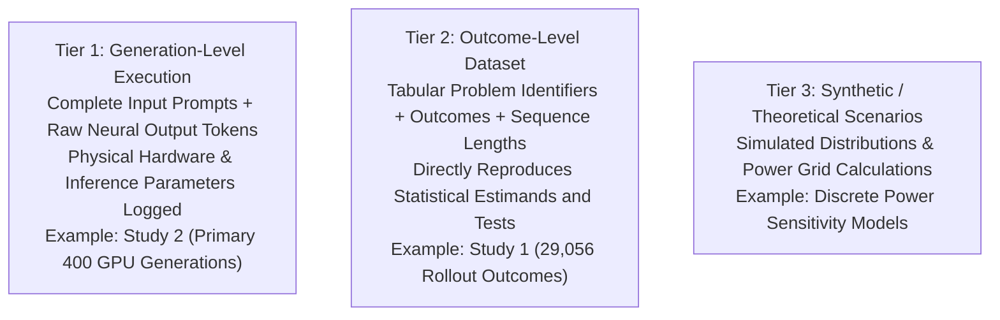

# Project StateShift: Data Provenance & Integrity Registry

**Principal Investigator**: Sham Satish Thakare (`github.com/shamddd`)
**Project**: StateShift: Tracking State-Dependent Reasoning Recovery Across Post-Training

---

## 1. Provenance Hierarchy & Classification Standards

Project StateShift enforces a strict data provenance hierarchy to distinguish experimental datasets according to their level of reproducibility:

---

## 2. Complete File Provenance Registry

| Dataset Path | Tier | SHA-256 Checksum | Size | Description |
| :--- | :---: | :--- | :---: | :--- |
| `data/study1/controlled_endpoint_outcomes.csv` | **Tier 2** | `49549bbd73349bb0e1879603bdbeb04c4a8617ab85d0b31323cfeb188a5c6139` | $1.62\text{ MB}$ | Study 1: 29,056 rollout outcome records across DeepScaleR-7B checkpoints. |
| `data/study2/stateshift_primary_400_generations.jsonl` | **Tier 1** | `bb1774557d9cf4059c9d8825530cac192e6813a93b10fe0948ce10b6522e69b2` | $741\text{ KB}$ | Study 2: 400 complete neural generations on RTX 4090 (Qwen2.5-Math-7B-Instruct). |
| `data/study2/final_verified_outcomes.csv` | **Tier 1** | `19a328a95dd25ec326fe824361386cc0ddf731f2bf1c392253be0aa19c2385ba` | $11.0\text{ KB}$ | Study 2: Verified outcome evaluations across conditions A, D, E, F. |
| `paper/source/STATESHIFT_ARXIV_RELEASE_SOURCE.zip` | **Release** | `2706cc14ad3f8451eefbd95b68ca316cb32714d9459d676b58414baad65b4470` | $798\text{ KB}$ | Cleanroom-verified LaTeX source archive for arXiv preprint submission. |
| `paper/STATESHIFT_ARXIV_RELEASE_CANDIDATE.pdf` | **Release** | `2da73dd1fc9372142314cda4c0fc45abf4aba24018f87346bb1a36ad129a262f` | $198\text{ KB}$ | Canonical compiled manuscript PDF (Tectonic 0.17.0). |

---

## 3. Decontamination and Data Sanitization

* **Study 1 Decontamination**: All 454 problem pairs were cross-referenced against the DeepScaleR-7B pre-training and alignment sets. The strict decontaminated subset ($N=388$) isolates problems with zero n-gram leakage, yielding $\Gamma_{\text{Strict}} = +11.60\text{ pp}$ ($p < 10^{-20}$).
* **Study 2 Neutrality**: Problems in Study 2 are drawn from the standardized MATH-500 test set, evaluated using fixed zero-temperature greedy generation without prompt modification of the test problem content.
