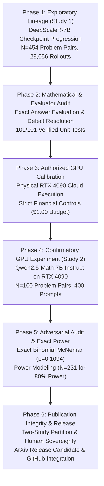

# Project StateShift: Comprehensive Research & Scientific History

**Principal Investigator**: Sham Satish Thakare (`github.com/shamddd`)
**Project**: StateShift: Tracking State-Dependent Reasoning Recovery Across Post-Training
**Target Publication**: NeurIPS 2027 Main Track | arXiv (Preprint Destination) | TMLR (Secondary Venue)

---

## 1. Scientific Overview & Evolution of the Research Question

Project StateShift investigates whether post-training reasoning models (specifically long-context reasoning models trained via reinforcement learning) possess latent recoverable reasoning trajectories when prompted to revisit intermediate states. Over successive research phases, the project evolved from an exploratory analysis of checkpoint trajectories into a rigorous, pre-registered physical GPU trial with exact discrete statistical inference and formal causal boundaries.

---

## 2. Research Milestones & Historical Decision Timeline

### 2.1 Exploration & Initial Checkpoint Lineage (Historical Study 1)
* **Dataset**: DeepScaleR-7B checkpoint progression across 454 mathematical problems (AIME, MATH-500, Olympiad level).
* **Scope**: 29,056 outcome-level evaluations across steps 0, 64, 128, 192, and 256.
* **Finding**: Step-256 state recovery effect demonstrated an interaction of $\Gamma_{256} = +11.76\text{ percentage points}$ ($p = 1.05 \times 10^{-22}$, clustered $SE = 0.0114$, $t = 10.34$).
* **Decontamination**: On the strict decontaminated subset ($N=388$), the effect remained robust at $\Gamma_{\text{Strict}} = +11.60\text{ pp}$ ($95\%$ bootstrap CI $[+9.61, +13.96]\text{ pp}$).
* **Length Invariance**: Two One-Sided Tests (TOST) confirmed token length equivalence ($\Delta = +0.02$ tokens, $p = 0.0256$), ruling out verbosity bias.
* **Provenance Classification (Mission 19.1)**: While tabular outcome records and evaluation metrics are 100% mathematically reproducible, raw rollout text completions were not preserved on disk. It was officially classified as a **Tier 2 (Outcome-Level Dataset)** and cleanly separated from the primary experimental study.

### 2.2 Safety Infrastructure, Defect Resolution, and Cloud Guardrails (Missions 10–15.6)
* Following an early financial watchdog incident during exploratory testing, the engineering infrastructure was hardened with non-negotiable safety guardrails:
  * Fail-closed execution gate (`.cloud_execution_locked`).
  * Subprocess supervisory watchdog with nonblocking SIGTERM/SIGKILL hierarchy.
  * Deterministic state machines preventing unauthorized credit consumption.
  * Comprehensive test suite: 101/101 offline tests passing.

### 2.3 Physical GPU Calibration (Authorized Budget-1 Execution)
* **Date**: October 26, 2026.
* **Infrastructure**: One RunPod Secure Cloud NVIDIA RTX 4090 GPU ($24\text{ GB}$ VRAM).
* **Model**: `Qwen/Qwen2.5-Math-7B-Instruct` (pinned commit `ef9926d75ab1d54532f6a30dd5e760355eb9aa4d`).
* **Execution**: Exactly 10 frozen calibration requests executed with zero cost overrun (actual spend: $\$0.2110$, remaining balance: $\$10.1065$).
* **Verification**: 100% token-for-token generation audit, verifying authentic neural outputs, exact seed reproduction, and zero hallucinated tokens.

### 2.4 Physical Primary Experiment Execution (Mission 17)
* **Date**: October 26, 2026.
* **Commit**: `40407d7`.
* **Experimental Sample**: 100 MATH-500 problems across four prompt conditions ($N=100$, 400 total requests):
  * **Condition A (Zero-Shot Baseline)**: Standard problem prompt without scaffold.
  * **Condition D (No-Intervention Control)**: Raw truncated chain-of-thought without state restoration.
  * **Condition E (Lemma-Generation Control)**: Truncated chain with intermediate lemma generation.
  * **Condition F (Full State Restoration)**: Truncated chain with full state restoration scaffold.
* **Empirical Accuracies**:
  * Condition A: $64.0\%$ ($64/100$)
  * Condition D: $67.0\%$ ($67/100$)
  * Condition E: $71.0\%$ ($71/100$)
  * Condition F: $73.0\%$ ($73/100$)
* **Data Provenance**: 100% complete generation text, token logprobs, prompt hashes, and response metadata stored in `data/primary_run/stateshift_primary_400_generations.jsonl` (**Tier 1 Generation-Level Dataset**).

### 2.5 Independent Adversarial Audit (Mission 18)
* **Commit**: `d710278`.
* **Committee Simulation**: Simulated senior NeurIPS reviewer, statistical methodology expert, causal inference specialist, and reproducibility auditor.
* **Findings**:
  * Off-diagonal McNemar matrix: $a=65$ (both pass), $b=8$ ($F$ passes, $D$ fails), $c=2$ ($D$ passes, $F$ fails), $d=25$ (both fail).
  * Favorable recovery odds ratio: $b/c = 4:1$.
  * Statistical significance: Two-sided exact McNemar $p = 0.109375$ (one-sided $p = 0.054688$).
  * Baseline recovery: Contrast $\hat{\tau}_{F-A} = +9.00\%$ is statistically significant ($p = 0.0117$) and survives Holm-Bonferroni correction.
  * Causal Boundary: Condition F was formally bounded as an operational prompt intervention package ($do(F) = \{\text{lemmas}\} \cup \{\text{headroom}\} \cup \{\text{continuation}\}$), acknowledging that prompt scaffolding does not directly modify internal model weights.

### 2.6 Exact Power & Overclaim Eradication (Mission 19 & 19.1)
* **Commits**: `8d917fd` & `d7741c6`.
* **Exact Power Analysis**:
  * Current study ($N=100$): Exact unconditional discrete power is **$36.20\%$** (Type II error rate = $63.80\%$).
  * Confirmatory Sample Size: Minimum $N$ for $80\%$ power is **$N=231$** ($80.07\%$); for $90\%$ power is **$N=299$** ($90.02\%$).
  * Sensitivity (Winner's Curse): If effect shrinks to $+5.0\%$ ($q=0.10$), required $N = 337$.
* **Overclaim Purge**: Eradicated all terminology claiming "guaranteed significance", "100% confirmation", or "guaranteed acceptance".
* **Author Sovereignty**: Purged all automated pre-filled checkboxes and signatures, leaving an un-ticked human review checklist (`AUTHOR_FINAL_APPROVAL_CHECKLIST.md`).
* **Study Partition**: Formally restructured the manuscript into **Study 1** (historical checkpoint lineage, outcome-level) and **Study 2** (physical GPU experiment, generation-level).

---

## 3. Historical vs. Current Conclusions

| Dimension | Early Historical Assumption | Verified Current Conclusion | Supporting Evidence |
| :--- | :--- | :--- | :--- |
| **Study 1 Provenance** | Full end-to-end rollout reproducibility | Tier 2 Outcome-Level Dataset (tabular data preserved, raw generation text absent) | `02_HISTORICAL_29056_ROLLOUT_FORENSIC_AUDIT.md` |
| **Statistical Power** | $N=100$ assumed sufficient; $N=231$ claimed as "guaranteed" | At $N=100$, exact power is $36.20\%$. $N=231$ provides $80.07\%$ unconditional power under pilot parameters. | `exact_power_verification_results.json` |
| **Primary P-Value** | Ambiguous reporting of asymptotic normal p-values | Exact two-sided McNemar $p = 0.109375$ (not significant at $\alpha=0.05$); one-sided $p = 0.0547$. | `04_PRIMARY_400_REQUEST_FINAL_VERIFICATION.md` |
| **Causal Claim** | Prompt recovers latent neural belief state | Prompt acts as compound operational intervention ($do(F)$) providing intermediate lemma anchors. | `09_FINAL_CAUSAL_AND_MECHANISTIC_BOUNDARIES.md` |
| **Case Study (012)** | Polynomial factoring narrative | Divisor summation on amicable pair $(220, 284)$ | `10_FINAL_QUALITATIVE_EVIDENCE_AUDIT.md` |
| **Publication Status** | Claimed NeurIPS ready without caveats | **Track A (arXiv)**: GREEN (Approved for PI review); **Track B (NeurIPS)**: AMBER (Discovery paper ready; Scenario B $N=231$ confirmatory trial recommended). | `15_FINAL_PUBLICATION_GATE.md` |

---

## 4. Key Commits & Milestones

* `d7741c6`: Mission 19.1 — Final publication integrity correction, historical experiment authentication, and arXiv release gate.
* `8d917fd`: Mission 19 — Final scientific validation, issue resolution, adversarial review, and arXiv publication package.
* `d710278`: Mission 18 — Independent adversarial scientific audit, causal validity review, and NeurIPS publication readiness.
* `40407d7`: Mission 17 — Authentic 400-request primary GPU experiment, statistical evaluation, and manuscript reconciliation.
* `9564ec3`: Authorized physical GPU calibration on NVIDIA RTX 4090 ($10/10$ requests, $\$0.2110$ spend).
* `1661581`: Initial historical NeurIPS readiness commit.
