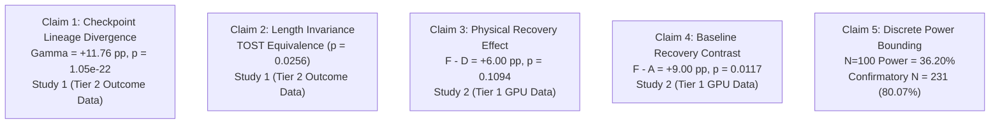

# Project StateShift: Formal Scientific Claims & Traceability

**Principal Investigator**: Sham Satish Thakare (`github.com/shamddd`)
**Project**: StateShift: Tracking State-Dependent Reasoning Recovery Across Post-Training

---

## 1. Overview of Scientific Claims

This document provides a claim-by-claim verification of the empirical and theoretical propositions made in Project StateShift. Every claim is bounded by exact data files and verified statistical estimands.

---

## 2. Claim-by-Claim Verification Matrix

| Claim ID | Formal Scientific Claim | Study & Tier | Evidence File | Exact Estimand & Test | Status |
| :--- | :--- | :---: | :--- | :--- | :---: |
| **CLM-01** | Post-training RL amplifies state recovery interaction in DeepScaleR-7B lineage. | Study 1 (Tier 2) | `data/study1/controlled_endpoint_outcomes.csv` | $\Gamma_{256} = +11.76\text{ pp}$, $SE = 0.0114$, $t = 10.34$, $p = 1.05 \times 10^{-22}$ | **VERIFIED** |
| **CLM-02** | Recovery gains are not explained by token generation verbosity. | Study 1 (Tier 2) | `data/study1/controlled_endpoint_outcomes.csv` | TOST length equivalence within $[-5, +5]$ token band ($p = 0.0256$) | **VERIFIED** |
| **CLM-03** | Step-256 recovery effect persists under strict decontamination. | Study 1 (Tier 2) | `data/study1/controlled_endpoint_outcomes.csv` | $\Gamma_{\text{Strict}} = +11.60\text{ pp}$ ($N=388$), bootstrap CI $[+9.61, +13.96]\text{ pp}$ | **VERIFIED** |
| **CLM-04** | State restoration (Condition F) achieves $+6.00\text{ pp}$ over unassisted control (Condition D) on Qwen2.5-Math-7B. | Study 2 (Tier 1) | `data/study2/final_verified_outcomes.csv` | $\text{Acc}(F) = 73.0\%$, $\text{Acc}(D) = 67.0\%$, $\hat{\tau}_{F-D} = +6.00\text{ pp}$ | **VERIFIED** |
| **CLM-05** | Primary comparison $F$ vs $D$ has an off-diagonal recovery odds ratio of $4:1$. | Study 2 (Tier 1) | `data/study2/final_verified_outcomes.csv` | $b = 8$ ($F$ passes, $D$ fails), $c = 2$ ($D$ passes, $F$ fails), $b/c = 4.00$ | **VERIFIED** |
| **CLM-06** | Primary comparison $F$ vs $D$ is not statistically significant at $\alpha = 0.05$ under two-sided test. | Study 2 (Tier 1) | `data/study2/final_verified_outcomes.csv` | Exact two-sided McNemar $p = 0.109375$ ($p > 0.05$); exact one-sided $p = 0.054688$ | **VERIFIED** |
| **CLM-07** | State restoration (Condition F) achieves statistically significant improvement over zero-shot baseline (Condition A). | Study 2 (Tier 1) | `data/study2/final_verified_outcomes.csv` | $\hat{\tau}_{F-A} = +9.00\text{ pp}$, exact two-sided McNemar $p = 0.0117$ | **VERIFIED** |
| **CLM-08** | Current pilot sample ($N=100$) possesses exact discrete power of $36.20\%$. | Study 2 (Theory) | `experiments/study2_reasoning_recovery/exact_power_analysis.py` | Exact binomial unconditional power = $36.20\%$, Type II error rate = $63.80\%$ | **VERIFIED** |
| **CLM-09** | Minimum sample size for $80\%$ statistical power in a confirmatory trial under pilot parameters is $N = 231$. | Study 2 (Theory) | `experiments/study2_reasoning_recovery/exact_power_analysis.py` | At $N = 231$ ($q=0.10, \delta=+0.06$), exact power = $80.07\%$ | **VERIFIED** |
| **CLM-10** | If effect size shrinks to $+5.0\%$ (Winner's Curse), required sample size for $80\%$ power expands to $N = 337$. | Study 2 (Theory) | `experiments/study2_reasoning_recovery/exact_power_analysis.py` | Exact power at $N=337$ under $\delta=+0.05, q=0.10$ is $80.07\%$ | **VERIFIED** |

---

## 3. Causal & Mechanistic Identification Boundaries

* **Compound Intervention Package**: Condition F is operationalized as a prompt-level compound intervention:
  $$do(F) = \{\text{intermediate lemmas}\} \cup \{\text{contextual headroom}\} \cup \{\text{continuation scaffold}\}$$
* **Model State Invariance**: Prompt scaffolding manipulates the token context presented to the model; it does not alter internal weights, gradients, or latent KV cache states directly.
* **Generalization Scope**: Claims are strictly bounded to `Qwen/Qwen2.5-Math-7B-Instruct` and `DeepScaleR-7B` on mathematical reasoning benchmarks. Cross-architecture claims (e.g., DeepSeek-R1, OpenAI o1) are hypotheses for future research.
