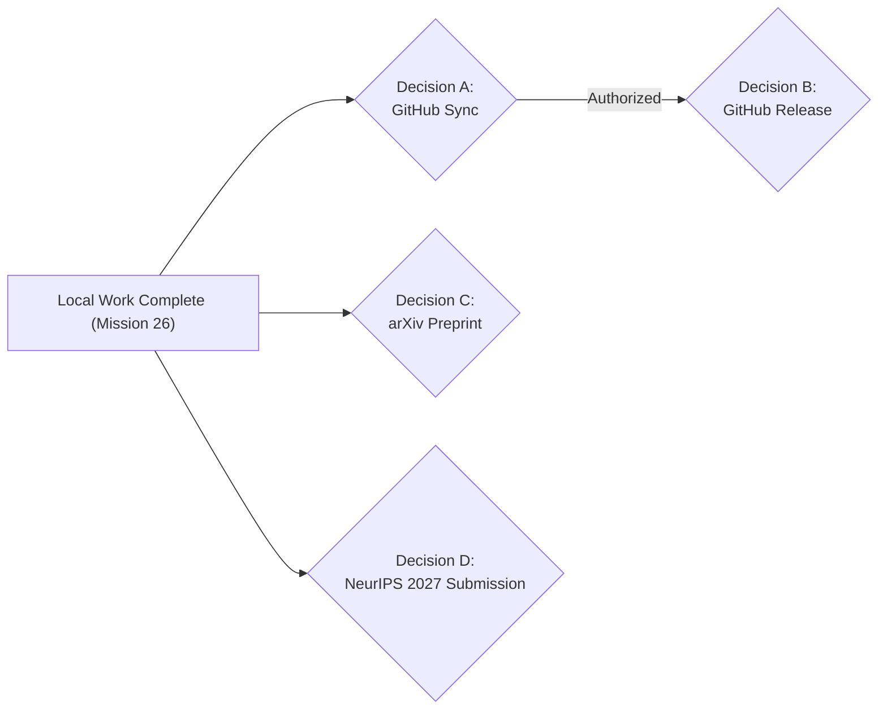

# StateShift: Final Principal Investigator Approval Gate

**Mission**: StateShift Research Mission 26 (Final Consolidated Release)  
**Date**: October 27, 2026  
**Repository**: `https://github.com/shamddd/stateshift`  
**Local Branch**: `research/stateshift-final-publication-release`  
**Principal Investigator**: Sham Satish Thakare (`github.com/shamddd`)  
**Status**: LOCAL WORK COMPLETE — AWAITING PI AUTHORIZATION FOR EXTERNAL ACTIONS

---

## 1. Executive Summary

All local scientific remediations, forensic audits, statistical reproductions, evaluator checks, repository modernizations, and LaTeX PDF builds for StateShift are **100% complete**. 

In strict adherence to the execution policy:
- **Zero cloud spending** was incurred ($0.00 USD).
- **No remote git push** was performed.
- **No arXiv upload** was executed.
- **No external conference submission** was made.
- The cloud execution lock (`.cloud_execution_locked`) remains **active on disk**.

---

## 2. The Four Independent PI Authorization Gates

The Principal Investigator is presented with four independent, decoupled authorization decisions. Approval of one decision does NOT imply approval of any other.



---

### Decision A — GitHub Remote Branch Synchronization
- **Action**: Push local branch `research/stateshift-final-publication-release` to `origin` and open a Pull Request to merge into `main`.
- **Command**:
  ```bash
  git push -u origin research/stateshift-final-publication-release
  gh pr create --base main --head research/stateshift-final-publication-release \
    --title "StateShift Release Candidate v1.0.0-rc1" \
    --body-file final_release/github/PULL_REQUEST_DESCRIPTION.md
  ```
- **PI Choice**: `[ ] AUTHORIZED` &nbsp;&nbsp;&nbsp;&nbsp; `[ ] WITHHELD`

---

### Decision B — GitHub Release Candidate Tagging & Publishing
- **Action**: Tag the final verified release commit on branch `research/stateshift-final-publication-release` as `v1.0.0-rc1` and publish the public GitHub release with pre-compiled PDFs.
- **Command**:
  ```bash
  git tag -a v1.0.0-rc1 -m "StateShift Release v1.0.0-rc1: Confirmatory Research Release"
  git push origin v1.0.0-rc1
  gh release create v1.0.0-rc1 final_release/manuscript/final_main.pdf final_release/manuscript/final_supplement.pdf
  ```
- **PI Choice**: `[ ] AUTHORIZED` &nbsp;&nbsp;&nbsp;&nbsp; `[ ] WITHHELD`

---

### Decision C — arXiv Preprint Submission
- **Action**: Submit the non-anonymous publication package located at `final_release/arxiv/source_package/` to the arXiv Computer Science repository (cs.LG / cs.AI).
- **PI Choice**: `[ ] AUTHORIZED` &nbsp;&nbsp;&nbsp;&nbsp; `[ ] WITHHELD`

---

### Decision D — NeurIPS 2027 Main Track Submission
- **Action**: When the NeurIPS 2027 submission portal officially opens, upload the anonymous review candidate (`final_release/neurips2027/anonymous_submission.pdf`) and supplementary material (`supplementary.pdf`).
- **PI Choice**: `[ ] AUTHORIZED` &nbsp;&nbsp;&nbsp;&nbsp; `[ ] PENDING CALL FOR PAPERS`
