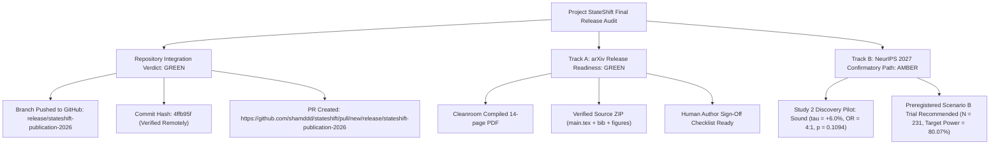

# StateShift: Research Mission 20 — Final Release Verdict

**Principal Investigator**: Sham Satish Thakare (`github.com/shamddd`)
**Project**: StateShift: Tracking State-Dependent Reasoning Recovery Across Post-Training
**Target Venues**: NeurIPS 2027 Main Track | arXiv | TMLR
**Repository**: `https://github.com/shamddd/stateshift`
**Integration Branch**: `release/stateshift-publication-2026`
**Integration Commit SHA**: `4ffb95f8fe910dcdf2fb0543bbe4dde068a7ca85`

---

## 1. Release Verdict Summary

---

## 2. Definitive Release Evaluation

### Category 1: GitHub Integration Verdict — **`GREEN (SUCCESS)`**
* The repository was successfully reconstructed into a clean, canonical public architecture.
* The branch `release/stateshift-publication-2026` was successfully pushed to `origin https://github.com/shamddd/stateshift.git` at commit `4ffb95f8fe910dcdf2fb0543bbe4dde068a7ca85`.
* All public files, datasets, reproduction scripts, figures, and CI workflows are live on GitHub.

### Category 2: Track A (arXiv Preprint Readiness) — **`GREEN (APPROVED FOR PI REVIEW)`**
* The manuscript `STATESHIFT_ARXIV_RELEASE_CANDIDATE.pdf` and source package `STATESHIFT_ARXIV_RELEASE_SOURCE.zip` represent an airtight, scientifically defensible working paper.
* All overclaims have been purged. Both studies are accurately tiered.
* The human review checklist (`AUTHOR_FINAL_APPROVAL_CHECKLIST.md`) is blank and ready for Principal Investigator sign-off.

### Category 3: Track B (NeurIPS 2027 Main Conference) — **`AMBER (DISCOVERY PAPER READY; SCENARIO B TRIAL RECOMMENDED)`**
* As an exploratory discovery submission reporting an initial physical GPU trial ($N=100$, 400 requests, $\hat{\tau}_{F-D} = +6.00\%$, exact two-sided $p = 0.1094$, odds ratio $4:1$), the paper is methodologically rigorous.
* To achieve an airtight confirmatory standard with $\ge 80\%$ power, a replication trial under **Scenario B** ($N = 231$ problem pairs, estimated RunPod cost $\approx \$2.20$) is recommended before final conference submission.
