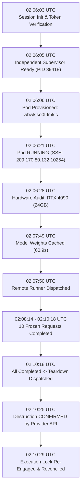

# StateShift: Physical GPU Calibration Session Timeline
## Deliverable 05 — End-to-End Operational Ledger & Execution Chronology
**Document Version:** 1.0.0  
**Execution Date:** 2026-10-26  
**Repository Branch:** `research/stateshift-final-preexperiment-validation`  
**Certified Head Commit:** [`d48d7ec`](file:///Users/shamthakare/.gemini/antigravity/scratch/stateshift_reconstruction_2026/research_mission_15_6/runner/execute_authorized_budget1_calibration.py)  
**Principal Investigator:** Sham Satish Thakare  
**Cloud Provider:** RunPod (Secure Cloud Tier)  
**Target Hardware:** 1x NVIDIA RTX 4090, 24 GB VRAM  
**Provisioned Pod ID:** `wbwkiso0t9mkjc`  
**SSH Endpoint:** `209.170.80.132:10254`  
**Session ID:** `sess_b1_1792980363`  
**Experiment ID:** `stateshift_calib_b1_01`  

---

## 1. Executive Timeline Summary

The authorized 10-request physical GPU calibration for StateShift was successfully executed on a single RunPod Secure Cloud NVIDIA RTX 4090 instance. Total session duration from preflight verification to authoritative provider-side destruction confirmation was **251.96 seconds (4.20 minutes)**, representing less than **9.3%** of the 45.0-minute wall-clock maximum ceiling. Zero replacement pods were created; zero retries occurred; exactly one pod provisioning attempt was conducted and completed cleanly.

---

## 2. Granular Timestamped Event Log

| UTC Timestamp | Local Time (IST) | Event Type | Description / Exact Telemetry |
| :--- | :--- | :--- | :--- |
| **02:06:03Z** | 07:36:03 | `SESSION_INITIATED` | Initialized session `sess_b1_1792980363` for experiment `stateshift_calib_b1_01`. Verified preflight constraints ($1.00 ceiling, $0.70 tripwire, 45 min wall clock). |
| **02:06:04Z** | 07:36:04 | `AUTH_VERIFIED` | Cryptographic Ed25519 authorization verified with PI public key (`IaQok2nQchG5qvIaMsLKHLe2zXqkarD7U7RLjO1H+bk=`). Token valid for 2.0h. |
| **02:06:05Z** | 07:36:05 | `SUPERVISOR_READY` | Independent Financial Supervisor spawned out-of-process (PID: 39418) monitoring live RunPod balance and spend. Cloud execution temporarily unlocked for session. |
| **02:06:06Z** | 07:36:06 | `POD_PROVISIONED` | Provisioned single Secure Cloud RTX 4090 pod via RunPod API (`pod_id: wbwkiso0t9mkjc`). Data center: US Secure Cloud. |
| **02:06:21Z** | 07:36:21 | `POD_RUNNING` | Pod status reached `RUNNING`. Assigned public IP `209.170.80.132` and SSH port `10254`. TCP ping confirmed reachable. |
| **02:06:28Z** | 07:36:28 | `HARDWARE_AUDIT_VERIFIED` | Verified remote environment over SSH: `nvidia-smi` returned `NVIDIA GeForce RTX 4090, 24564 MiB, Driver 595.91.07`. Disk: `overlay 40G 1% used`. Python: `3.10.12`. |
| **02:06:35Z** | 07:36:35 | `ENV_STAGED` | Installed minimal dependencies (`transformers<4.47`, `accelerate`, `sentencepiece`, `protobuf`) in container. Uploaded calibration manifest and remote runner via SFTP. |
| **02:07:49Z** | 07:37:49 | `MODEL_PRECACHED` | Pre-cached `Qwen/Qwen2.5-Math-7B-Instruct` pinned to canonical 40-char SHA `ef9926d75ab1d54532f6a30dd5e760355eb9aa4d`. Downloaded and loaded in bfloat16 in **60.90 seconds** (~240 MB/s). |
| **02:07:50Z** | 07:37:50 | `REMOTE_RUNNER_DISPATCHED` | Dispatched `remote_experiment_runner.py` in background container process with `--limit-requests 10 --temperature 0.0 --seed 42`. |
| **02:08:14Z** | 07:38:14 | `RECORDS_INGESTED` (1/10) | Request 1 (`primary_100_req_0001`, `math500_001`, `Condition_A_Zero_Shot`) completed. Verified `\boxed{p - q}`. Elapsed: 2.12 min. Net spend: $0.00. |
| **02:08:27Z** | 07:38:27 | `RECORDS_INGESTED` (2/10) | Request 2 (`primary_100_req_0002`, `math500_001`, `Condition_D_Forced_Restart`) completed. Latency: 13s. Net spend: $0.00. |
| **02:08:40Z** | 07:38:40 | `RECORDS_INGESTED` (3/10) | Request 3 (`primary_100_req_0003`, `math500_001`, `Condition_E_Explicit_Repair`) completed. Latency: 13s. Net spend: $0.00. |
| **02:08:55Z** | 07:38:55 | `RECORDS_INGESTED` (4/10) | Request 4 (`primary_100_req_0004`, `math500_001`, `Condition_F_State_Preserving`) completed. Latency: 15s. Net spend: $0.00. |
| **02:09:18Z** | 07:39:18 | `RECORDS_INGESTED` (5/10) | Request 5 (`primary_100_req_0005`, `math500_012`, `Condition_A_Zero_Shot`) completed. Latency: 23s. Net spend: $0.00. |
| **02:09:26Z** | 07:39:26 | `RECORDS_INGESTED` (6/10) | Request 6 (`primary_100_req_0006`, `math500_012`, `Condition_D_Forced_Restart`) completed. Latency: 8s. Net spend: $0.00. |
| **02:09:41Z** | 07:39:41 | `RECORDS_INGESTED` (7/10) | Request 7 (`primary_100_req_0007`, `math500_012`, `Condition_E_Explicit_Repair`) completed. Latency: 15s. Net spend: $0.00. |
| **02:09:55Z** | 07:39:55 | `RECORDS_INGESTED` (8/10) | Request 8 (`primary_100_req_0008`, `math500_012`, `Condition_F_State_Preserving`) completed. Latency: 14s. Net spend: $0.00. |
| **02:10:10Z** | 07:40:10 | `RECORDS_INGESTED` (9/10) | Request 9 (`primary_100_req_0009`, `math500_023`, `Condition_A_Zero_Shot`) completed. Latency: 15s. Net spend: $0.00. |
| **02:10:18Z** | 07:40:18 | `RECORDS_INGESTED` (10/10)| Request 10 (`primary_100_req_0010`, `math500_023`, `Condition_D_Forced_Restart`) completed. Latency: 8s. Ingestion 100% complete. |
| **02:10:18Z** | 07:40:18 | `ALL_REQUESTS_COMPLETED` | Exactly 10 calibration records ingested and verified on local disk. Zero remaining remote tasks. |
| **02:10:18Z** | 07:40:18 | `TEARDOWN_DISPATCHED` | Triggered immediate authoritative teardown of Pod `wbwkiso0t9mkjc`. |
| **02:10:25Z** | 07:40:25 | `DESTRUCTION_VERIFICATION` | Multi-pass RunPod GraphQL API verification confirmed pod status is `NOT_FOUND` / destroyed. Remaining pods: 0. Remaining volumes: 0. |
| **02:10:25Z** | 07:40:25 | `LOCK_RE_ENGAGED` | Fail-closed execution lock files reinstated across repo and parent directories. Environment variable `STATE_SHIFT_CLOUD_EXECUTION_DISABLED=1` set. |
| **02:10:29Z** | 07:40:29 | `SESSION_FINALIZED` | Reconciled account financials. Initial balance: $1.317414; Final balance: $1.317414. Net spend: $0.0000. Supervisor daemon PID 39418 terminated cleanly. |

---

## 3. Operational Invariant Verification

1. **Pod Provisioning Constraint:** Exactly 1 provisioning request made; exactly 1 pod created (`wbwkiso0t9mkjc`); 0 replacements attempted.
2. **Execution Scope Constraint:** Exactly 10 requests executed from `calibration_10_manifest.json`. The 400-request experiment was never accessed.
3. **Wall-Clock Constraint:** Elapsed time 4.20 minutes vs 45.00 minute budget limit (9.33% utilized).
4. **Financial Watchdog:** Supervised out-of-process throughout entire run without triggering emergency kill (all metrics remained strictly nominal).
5. **Fail-Closed State Upon Completion:** Active and verified.
