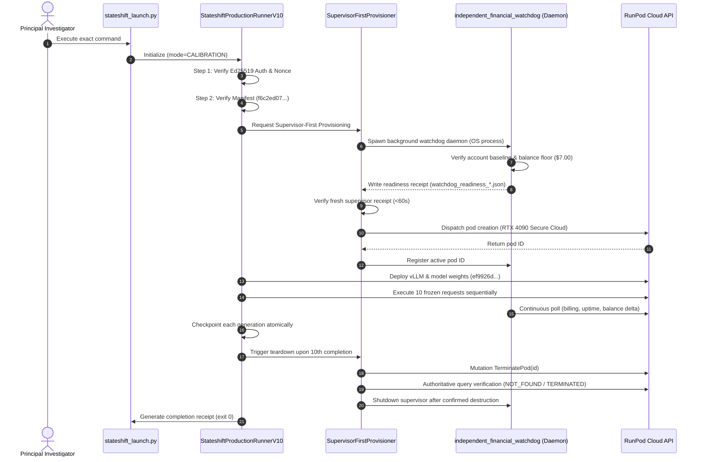

# StateShift — Exact Future Calibration Command Specification
## Calibration Readiness Phase 6 & 8
**Document Type:** Technical Execution Specification  
**Status:** DRAFT / PRE-FLIGHT ONLY — EXECUTION PROHIBITED  
**Target Environment:** One RunPod Secure Cloud RTX 4090 (24 GB VRAM)  
**Model:** `Qwen/Qwen2.5-Math-7B-Instruct` @ `ef9926d75ab1d54532f6a30dd5e760355eb9aa4d`  

---

> [!CAUTION]
> **DO NOT EXECUTE THIS COMMAND.**
> This document specifies the exact command and runtime environment required for a future authorized session. Executing this command prior to explicit human authorization, account replenishment, and cryptographic key generation is strictly prohibited by project safety invariants.

---

## 1. Canonical Entry Point & Architecture

- **Launcher Script:** `research_mission_15_6/runner/stateshift_launch.py`
- **Execution Engine:** `research_mission_15_6/runner/stateshift_production_runner_v10.py`
- **Provisioning & Lifecycle Controller:** `research_mission_15_6/deployment/supervisor_first_provisioner.py`
- **Independent Supervisor Daemon:** `research_mission_15_6/supervision/independent_financial_watchdog.py`

---

## 2. Required Environment Variables

Prior to launching any authorized session, the following environment variables must be exported in the execution shell:

```bash
# 1. Cloud Execution Unlock (Strictly during authorized window only)
export STATE_SHIFT_CLOUD_EXECUTION_DISABLED=0

# 2. RunPod Provider Credentials
export RUNPOD_API_KEY="<PI_CONFIDENTIAL_RUNPOD_API_KEY>"

# 3. SSH Private Key for Secure Cloud Pod Interconnect
export RUNPOD_SSH_KEY_PATH="/Users/shamthakare/.ssh/id_ed25519"

# 4. Strict Non-Interactive Environment
export PYTHONUNBUFFERED=1
```

---

## 3. Required Cryptographic Authorization File

A freshly minted, Ed25519-signed authorization file must be placed on disk:
- **Location:** `data/primary_run/session_auth_calibration.json`
- **Schema Version:** `1.0`
- **Mandatory Fields in Signed Payload:**
  - `schema_version`: `"1.0"`
  - `experiment_id`: `"stateshift_calib_20261026_01"`
  - `manifest_sha256`: `"f6c2ed07a50e5d4cec5ff4f24c5c7ef0355841fcec39b3b9d8b6d86385cb0de6"`
  - `model_id`: `"Qwen/Qwen2.5-Math-7B-Instruct"`
  - `model_revision`: `"ef9926d75ab1d54532f6a30dd5e760355eb9aa4d"`
  - `pod_id`: `"PRE_PROVISION"`
  - `max_incremental_spend_usd`: `0.60`
  - `emergency_trigger_usd`: `0.25`
  - `minimum_account_balance_usd`: `7.00`
  - `maximum_runtime_minutes`: `25.0`
  - `nonce`: `<FRESH_UUID4_HEX>`
  - `issued_at_utc`: `<CURRENT_UNIX_TIMESTAMP>`
  - `expiry_utc`: `<CURRENT_UNIX_TIMESTAMP + 1800>`

---

## 4. Exact Execution Command

```bash
cd /Users/shamthakare/.gemini/antigravity/scratch/stateshift_reconstruction_2026 && \
python -m research_mission_15_6.runner.stateshift_launch \
    --mode calibration \
    --experiment-id stateshift_calib_20261026_01 \
    --manifest research_mission_15_6/manifests/calibration_10_manifest.json \
    --authorization data/primary_run/session_auth_calibration.json \
    --trusted-public-key /Users/shamthakare/.ssh/stateshift_pi_ed25519.pub \
    --local-data-dir data/primary_run \
    --remote-work-dir /workspace/stateshift_run \
    --max-cost 0.60 \
    --max-runtime 25.0 \
    --gpu-rate 0.89 \
    --poll-interval 1.0 \
    2>&1 | tee stateshift_calibration_session.log
```

---

## 5. Expected Runtime Processes & Sequencing



---

## 6. Expected Artifacts and File Outputs

### 6.1 Generation Dataset
- `data/primary_run/stateshift_calib_20261026_01_generations.jsonl`
  - Exactly 10 JSON records.
  - Request IDs: `primary_100_req_0001` through `primary_100_req_0010`.
  - Condition codes: 3 Condition A, 3 Condition D, 2 Condition E, 2 Condition F.
  - Model provenance: `Qwen/Qwen2.5-Math-7B-Instruct` @ `ef9926d75ab1d54532f6a30dd5e760355eb9aa4d`.
  - Decoding metadata: `temperature: 0.0`, `max_tokens: 768`, `seed: 42`, `sampling_mode: "greedy"`.

### 6.2 Supervisor & Audit Telemetry
- `data/primary_run/watchdog/watchdog_state_stateshift_calib_20261026_01.json`
- `data/primary_run/watchdog/watchdog_readiness_*.json`
- `data/primary_run/watchdog/watchdog_register_pod_*.json`
- `data/primary_run/audit_log_stateshift_calib_20261026_01.jsonl`

### 6.3 Termination & Financial Reconciliation Receipts
- `data/primary_run/termination_receipt_stateshift_calib_20261026_01.json`
  - Confirms provider status as `TERMINATED` or `NOT_FOUND`.
  - Documents total pod runtime (seconds) and authoritative destruction timestamp.
- `data/primary_run/shutdown_state_stateshift_calib_20261026_01.json`
- `data/primary_run/financial_reconciliation_stateshift_calib_20261026_01.json`
  - Reconciles initial account balance, final account balance, provider estimated charges, and watchdog observed spend.

---

## 7. Immediate Post-Run Execution Lock Restoration

Immediately following runner exit (regardless of return code 0, 1, or 2), the execution shell must restore the fail-closed lock:

```bash
export STATE_SHIFT_CLOUD_EXECUTION_DISABLED=1
python3 -c "
import json
with open('.cloud_execution_locked', 'w') as f:
    json.dump({
        'locked': True,
        'reason': 'Routine re-locking following calibration execution.',
        'timestamp': '$(date -u +\"%Y-%m-%dT%H:%M:%SZ\")'
    }, f, indent=2)
"
```
