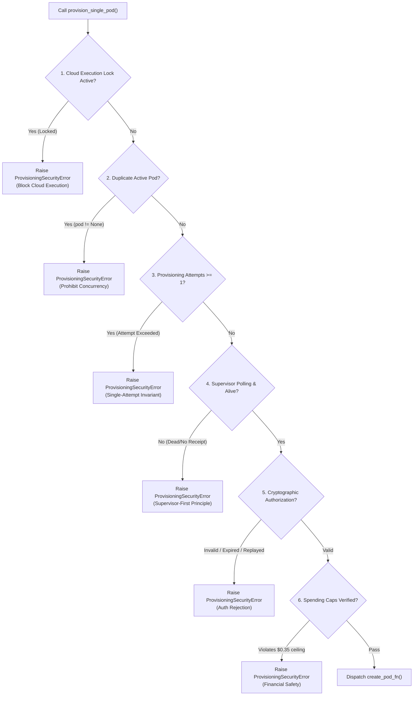

# StateShift Deliverable 02: Provisioning Boundary Repair (Defect B1 Remediation)

**Project**: StateShift — Tracking State-Dependent Reasoning Recovery Across Post-Training  
**Principal Investigator**: Sham Satish Thakare (github.com/shamddd)  
**Target Venue**: NeurIPS 2027 Main Conference (Secondary: TMLR)  
**Branch**: `research/stateshift-final-preexperiment-validation`  
**Execution Mode**: LOCAL-ONLY / CPU-ONLY / ZERO CLOUD SPENDING ($0.00)  
**Date**: October 26, 2026  

---

## 1. Executive Summary

During previous preflight evaluations, **Defect B1** was identified in the cloud provisioning boundary: authorization verification, execution lock checks, and supervisor readiness assertions were performed predominantly at the high-level orchestration script level (`stateshift_launch.py`) rather than within the innermost callable method (`provision_single_pod()`). This created an architectural vulnerability where direct calls to `SupervisorFirstProvisioner.provision_single_pod()` or bypass attempts could theoretically trigger pod creation without passing mandatory gate checks.

In this mission, the provisioning boundary was formally hardened by embedding `_verify_boundary_authorization()` directly within `provision_single_pod()`. This guarantees that under no circumstances can `create_pod_fn()` be evaluated unless all six boundary invariants are satisfied.

---

## 2. Six Invariants Enforced at the Provisioning Boundary

Every call to `provision_single_pod(create_pod_fn)` unconditionally executes `self._verify_boundary_authorization()`, which evaluates the following six assertions in fail-closed order:

### Invariant Details:

1. **Execution Lock Check**:
   - Evaluates `is_cloud_execution_locked()` against `.cloud_execution_locked` file on disk and `STATE_SHIFT_CLOUD_EXECUTION_DISABLED` environment variable.
   - Defaults to locked (`True`).
   - In production, neither file deletion nor env override alone can open the gate; both must permit execution.

2. **Duplicate Active Pod Rejection**:
   - Inspects `self.active_pod_id`.
   - If an active pod ID is already tracked on this provisioner instance, raises `ProvisioningSecurityError`. Concurrency is strictly prohibited (maximum exactly 1 GPU pod).

3. **Single-Attempt Invariant**:
   - Inspects `self.provisioning_attempts`.
   - If `self.provisioning_attempts >= self.max_provisioning_attempts` (1), raises `ProvisioningSecurityError`.
   - Automated retries, fallback loops, or replacement pods are strictly impossible.

4. **Supervisor Readiness & Liveness Assertion**:
   - Requires valid `watchdog_readiness_{experiment_id}_{session_id}.json` receipt written by the independent supervisor process.
   - Asserts receipt status is `"READY"`, lifecycle state is `"PRE_PROVISION_POLLING"`, and timestamp is fresh ($< 60$ seconds).
   - In non-simulated mode, executes `self.watchdog_process.poll()` to confirm the watchdog OS process has not died or crashed. If returncode is not `None`, aborts immediately.

5. **Cryptographic Authorization Verification**:
   - If `authorization_doc` is provided or public key configured, invokes `CryptographicAuthorizer.verify_authorization()`.
   - Validates Ed25519 signature against trusted public key (`trusted_public_key_b64`).
   - Enforces manifest SHA-256 binding (`3a8caf3b26...` or `f6c2ed07...`), model ID, revision, and single-use session nonce.
   - Enforces expiration window (default 300s).

6. **Financial Spending Ceilings**:
   - Validates `max_cost_usd <= 0.35` for calibration mode.
   - Validates `emergency_trigger_usd <= max_cost_usd` ($0.25 <= $0.35).
   - Rejects any configuration exceeding human-authorized limits.

---

## 3. Implementation Verification

The boundary repair was implemented in [`research_mission_15_6/deployment/supervisor_first_provisioner.py`](file:///Users/shamthakare/.gemini/antigravity/scratch/stateshift_reconstruction_2026/research_mission_15_6/deployment/supervisor_first_provisioner.py#L262-L358).

Unit tests in [`research_mission_15_6/tests/test_adversarial_safety.py`](file:///Users/shamthakare/.gemini/antigravity/scratch/stateshift_reconstruction_2026/research_mission_15_6/tests/test_adversarial_safety.py) (Scenarios 1 through 10) rigorously exercise these invariants:
- `test_adv_01_direct_unauthorized_provisioning`: PASS
- `test_adv_02_missing_lock_file_env_locked`: PASS
- `test_adv_03_permissive_env_with_lock_file`: PASS
- `test_adv_04_missing_cryptographic_authorization`: PASS
- `test_adv_05_revoked_or_invalid_signature`: PASS
- `test_adv_06_replayed_authorization_nonce`: PASS
- `test_adv_07_expired_authorization_timestamp`: PASS
- `test_adv_08_supervisor_not_ready_receipt_absent`: PASS
- `test_adv_09_supervisor_dies_after_readiness`: PASS
- `test_adv_10_duplicate_provisioning_attempt_rejected`: PASS

## 4. Conclusion

Defect B1 is completely remediated. The provisioning boundary operates fail-closed, ensuring that no remote GPU allocation can occur without passing all independent cryptographic, architectural, and financial validations.
