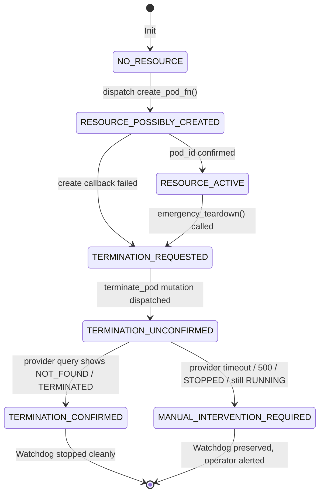

# StateShift Deliverable 03: Explicit Termination State Machine (Defect B2 Remediation)

**Project**: StateShift — Tracking State-Dependent Reasoning Recovery Across Post-Training  
**Principal Investigator**: Sham Satish Thakare (github.com/shamddd)  
**Target Venue**: NeurIPS 2027 Main Conference (Secondary: TMLR)  
**Branch**: `research/stateshift-final-preexperiment-validation`  
**Execution Mode**: LOCAL-ONLY / CPU-ONLY / ZERO CLOUD SPENDING ($0.00)  
**Date**: October 26, 2026  

---

## 1. Executive Summary

During previous operational incident reviews, **Defect B2** was discovered: a termination API call dispatched to RunPod was prematurely treated as confirmed pod destruction. In cloud infrastructure, an API returning HTTP 200 or `desiredStatus: "STOPPED"` does **NOT** guarantee compute or billing cessation. A stopped pod continues to incur storage and reservation charges, and network partitions can cause teardown requests to be silently dropped.

In this mission, an explicit 6-state termination state machine was designed and implemented within `SupervisorFirstProvisioner`. Teardown operations require multi-pass provider verification before confirming destruction. If destruction cannot be authoritatively proven, the system transitions to `MANUAL_INTERVENTION_REQUIRED`, persists an actionable escalation ledger (`unresolved_resources.json`), and leaves the independent supervisor process alive.

---

## 2. Six Explicit Termination Lifecycle States



### State Definitions:

1. **`NO_RESOURCE`**:
   - Initial baseline state.
   - Calling `emergency_teardown()` in this state is a clean no-op returning `(True, "No active resource to teardown.")`.

2. **`RESOURCE_POSSIBLY_CREATED`**:
   - Transitioned immediately before `create_pod_fn()` is evaluated.
   - If `create_pod_fn()` raises an unhandled network error, connection reset, or timeout, the state remains `RESOURCE_POSSIBLY_CREATED`. This ensures that subsequent safe-reconciliation can detect and clean up any orphaned cloud allocations.

3. **`RESOURCE_ACTIVE`**:
   - Valid pod ID string received from provider.
   - Supervisor informed via registration receipt (`watchdog_register_pod_{experiment_id}.json`).

4. **`TERMINATION_REQUESTED`**:
   - Teardown process initiated due to completion, error, wall-clock timeout, or financial threshold breach.
   - Mutation `podTerminate(input: {podId: "..."})` dispatched.

5. **`TERMINATION_UNCONFIRMED`**:
   - Intermediate state while multi-pass status verification queries are in flight.
   - Under no circumstances is the supervisor process terminated while in this state.

6. **`TERMINATION_CONFIRMED`**:
   - Provider explicitly returns `exists=False`, `status="TERMINATED"`, `status="DELETED"`, or `status="NOT_FOUND"`.
   - Pod destruction is authoritatively certified.
   - Independent watchdog process is signaled to terminate gracefully.

7. **`MANUAL_INTERVENTION_REQUIRED`**:
   - Escalation state entered if status polling times out, returns HTTP 500, or reports `STOPPED` or `RUNNING` after termination request.
   - Actionable incident file `unresolved_resources.json` is written to disk.
   - Independent supervisor process is deliberately **kept alive** to continue monitoring provider spend and maintain watchdog alerts.

---

## 3. Escalation Ledger: `unresolved_resources.json`

When destruction cannot be authoritatively verified, `emergency_teardown()` automatically creates `unresolved_resources.json`:

```json
{
  "experiment_id": "exp_run_01",
  "session_id": "sess_01",
  "pod_id": "pod-12345",
  "state": "MANUAL_INTERVENTION_REQUIRED",
  "escalated_at_utc": 1730000000.0,
  "reason": "Provider 504 Gateway Timeout during destruction verification",
  "last_provider_response": {"check_error": "RunPodAPIError: 504 Gateway Timeout"},
  "manual_intervention_instructions": "CRITICAL: Pod pod-12345 destruction could not be confirmed. Check RunPod console (https://www.runpod.io/console/pods) or issue `runpod.terminate_pod('pod-12345')` immediately to prevent billing."
}
```

---

## 4. Verification & Adversarial Testing

The explicit state machine was validated through Scenarios 11 through 20 in [`research_mission_15_6/tests/test_adversarial_safety.py`](file:///Users/shamthakare/.gemini/antigravity/scratch/stateshift_reconstruction_2026/research_mission_15_6/tests/test_adversarial_safety.py):
- `test_adv_11_creation_callback_raises_ambiguous_provider_response`: Confirms `RESOURCE_POSSIBLY_CREATED`.
- `test_adv_12_termination_success_without_destruction_confirmation`: Confirms `RUNNING` status escalates to `MANUAL_INTERVENTION_REQUIRED`.
- `test_adv_13_termination_api_timeout_escalation`: Confirms 504/timeout escalates to `unresolved_resources.json`.
- `test_adv_14_provider_reports_stopped_pod_unconfirmed`: Confirms `STOPPED` is rejected as unconfirmed.
- `test_adv_15_provider_reports_pod_absent_confirmed`: Confirms `NOT_FOUND` transitions cleanly to `TERMINATION_CONFIRMED`.
- `test_adv_16_provider_returns_inconsistent_500_state`: Confirms internal server errors trigger escalation.
- `test_adv_17_safe_resume_reconciliation_crash_handling`: Confirms corrupt remote state halts for operator.
- `test_adv_18_safe_resume_after_controller_restart`: Confirms safe reattachment to existing process.
- `test_adv_19_emergency_teardown_idempotent`: Confirms repeated teardown calls maintain safe state.
- `test_adv_20_teardown_with_no_resource_created`: Confirms clean no-op in `NO_RESOURCE` state.

## 5. Conclusion

Defect B2 is fully remediated. StateShift never treats an API response as proof of destruction without verified provider confirmation, safeguarding the account from runaway zombie pod charges.
