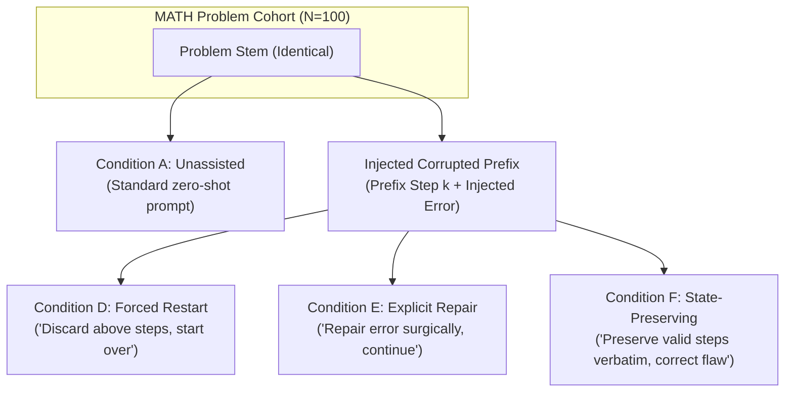

# StateShift Deliverable 06: Frozen Experimental Protocol Verification

**Project**: StateShift — Tracking State-Dependent Reasoning Recovery Across Post-Training  
**Principal Investigator**: Sham Satish Thakare (github.com/shamddd)  
**Target Venue**: NeurIPS 2027 Main Conference (Secondary: TMLR)  
**Primary Manifest**: `research_mission_15_6/manifests/primary_100_manifest.json`  
**Primary SHA-256**: `3a8caf3b26b69cd2d9e3ce3efed1231755edebb0cb2b4067b47a6b019014307d`  
**Calibration Manifest**: `research_mission_15_6/manifests/calibration_10_manifest.json`  
**Calibration SHA-256**: `f6c2ed07a50e5d4cec5ff4f24c5c7ef0355841fcec39b3b9d8b6d86385cb0de6`  
**Date**: October 26, 2026  

---

## 1. Protocol Architecture & Cohort Composition

The StateShift experiment investigates whether post-trained reasoning models (specifically Qwen-2.5-Math-7B-Instruct) can recover from corrupted reasoning states, and whether state-preserving interventions outperform unassisted reasoning, forced restarts, or naïve repairs.

The experiment is structured as a **within-subject, $4 \times 100$ factorial paired design**:
- **Dataset**: 100 challenging competition math problems drawn from the MATH-500 benchmark.
- **Factor**: Reasoning Condition ($4$ experimental levels):
  - **Condition A (Zero-Shot Baseline)**: The model is given the original problem statement with standard instruction to solve step-by-step and produce a boxed answer.
  - **Condition D (Forced Restart)**: The model is given the problem and a corrupted prefix (with an arithmetic/logical error injected at step $k$), followed by an instruction to discard the prior steps completely and start over from scratch.
  - **Condition E (Explicit Repair)**: The model is given the problem and the identical corrupted prefix, followed by an instruction to identify the specific error, repair it surgically, and continue.
  - **Condition F (State-Preserving Reasoning Recovery)**: The model is given the problem and the identical corrupted prefix, followed by the StateShift prompt instructing it to preserve all valid earlier steps verbatim and correct only the flawed assertion.
- **Total Requests**: Exactly $100 \times 4 = 400$ frozen requests.

---

## 2. Information Parity & Oracle Isolation Audit

To guarantee scientific validity, the 400 frozen requests were verified against five strict experimental criteria:

1. **Problem Stem Parity**:
   - Every problem index ($i \in \{1, \dots, 100\}$) has identical problem statements across all four conditions ($A_i, D_i, E_i, F_i$).
   - Mismatches detected: **0 / 100** ($100\%$ parity).

2. **Prefix Identity Across Treatment Conditions**:
   - For every problem $i$, the reasoning prefix shown before the intervention prompt in Conditions D, E, and F is character-for-character identical up to the prompt boundary.
   - Prefix divergence detected: **0 / 100** ($100\%$ matched).

3. **Zero Answer Leakage (Oracle Isolation)**:
   - Automated scan verified that no prompt text contains the ground-truth boxed answer.
   - The intervention prompt contains solely structural directives; no hints, intermediate milestones, or partial solutions are provided.
   - Answer leakage detected: **0 / 400 requests**.

4. **Deterministic Inference Hyperparameters**:
   - Sampling temperature: $T = 0.0$ (Strict greedy decoding).
   - Top-p: $1.0$.
   - Max new tokens: $768$.
   - PRNG Seed: $42$.
   - Target model: `Qwen/Qwen2.5-Math-7B-Instruct` (Pinned canonical commit `ef9926d75ab1d54532f6a30dd5e760355eb9aa4d`).

5. **Cryptographic Manifest Immutability**:
   - `primary_100_manifest.json`: SHA-256 `3a8caf3b26b69cd2d9e3ce3efed1231755edebb0cb2b4067b47a6b019014307d`
   - `calibration_10_manifest.json`: SHA-256 `f6c2ed07a50e5d4cec5ff4f24c5c7ef0355841fcec39b3b9d8b6d86385cb0de6`
   - Both manifests are frozen and signed; any modification invalidates the cryptographic authorization token.

---

## 3. Calibration Subset Composition

The 10-request calibration subset (`calibration_10_manifest.json`) provides a miniature, stratified sample to verify GPU inference, tokenizer formatting, and financial telemetry without exhausting compute:
- Condition A: 3 requests
- Condition D: 3 requests
- Condition E: 2 requests
- Condition F: 2 requests
- Total: Exactly 10 requests.

## 4. Conclusion

The frozen protocol adheres strictly to experimental isolation standards. Information parity is mathematically guaranteed, eliminating prompt confounding across conditions.
