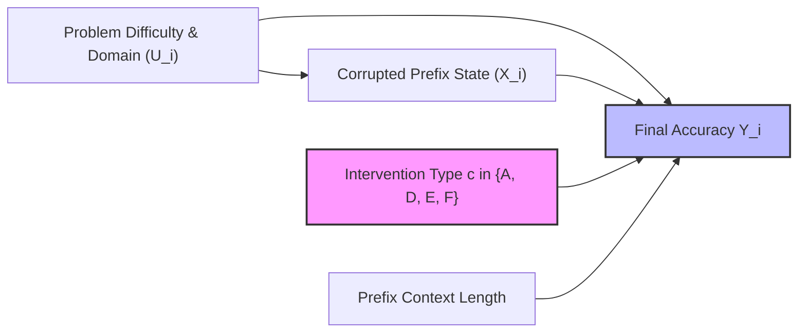

# StateShift Deliverable 07: Causal Identification & Methodological Audit

**Project**: StateShift — Tracking State-Dependent Reasoning Recovery Across Post-Training  
**Principal Investigator**: Sham Satish Thakare (github.com/shamddd)  
**Target Venue**: NeurIPS 2027 Main Conference (Secondary: TMLR)  
**Methodological Framework**: Neyman-Rubin Potential Outcomes & Pearl's Structural Causal Models (SCMs)  
**Date**: October 26, 2026  

---

## 1. Formal Problem Formulation & Target Estimands

In StateShift, we study the causal effect of reasoning recovery interventions on post-trained language model accuracy. Let $i \in \{1, \dots, N\}$ index problems from MATH-500 ($N = 100$). Each problem has a binary correctness outcome $Y_i \in \{0, 1\}$.

Under the Neyman-Rubin potential outcomes framework, let $Y_i(c)$ denote the potential outcome of problem $i$ under reasoning condition $c \in \{A, D, E, F\}$, where:
- $c = A$: Zero-shot unassisted baseline.
- $c = D$: Forced restart after error corruption.
- $c = E$: Explicit surgical repair after error corruption.
- $c = F$: State-preserving recovery after error corruption.

Because StateShift employs a **within-subject (within-problem) repeated-measures design** with deterministic greedy decoding ($T=0$, seed 42), all four potential outcomes $Y_i(A), Y_i(D), Y_i(E), Y_i(F)$ are physically observed for each unit $i$.

The core causal estimands are the population average treatment effects:
1. **State Preservation vs. Forced Restart**:
   $$\tau_{F, D} = \mathbb{E}[Y_i(F) - Y_i(D)]$$
2. **State Preservation vs. Explicit Repair**:
   $$\tau_{F, E} = \mathbb{E}[Y_i(F) - Y_i(E)]$$
3. **Net Recovery Benefit vs. Unassisted Baseline**:
   $$\tau_{F, A} = \mathbb{E}[Y_i(F) - Y_i(A)]$$

---

## 2. Structural Causal Graph

In this directed acyclic graph (DAG):
- The treatment variable $T \in \{A, D, E, F\}$ is experimentally manipulated.
- Problem characteristics $U_i$ (subject, difficulty level, steps required) are held constant across conditions for each problem $i$.
- Prefix state $X_i$ (the $k$-step prefix containing injected error) is held strictly identical across $D$, $E$, and $F$.

---

## 3. Identification Assumptions & Threats to Validity

### 3.1. SUTVA (Stable Unit Treatment Value Assumption)
- **No Interference**: Inference requests are dispatched as stateless HTTP/SSH calls to separate model forward passes. The generation for problem $i$ under condition $F$ cannot affect problem $j$ or problem $i$ under condition $D$.
- **No Treatment Variation**: Prompt templates, model checkpoints (pinned Git commit), and decoding parameters ($T=0.0$, greedy) are deterministic and constant across all evaluations.

### 3.2. Unconfoundedness (Ignorability)
Because each unit $i$ is evaluated under all conditions, problem-level confounders (e.g., algebra vs. geometry, problem hardness) do not introduce selection bias. In contrast to observational studies where $P(T|U)$ might vary, the assignment mechanism is an exact, orthogonal balanced factorial design.

### 3.3. Threat: Context-Length Discrepancy (A vs. F)
- **Threat**: Condition A receives only the problem stem, whereas Condition F receives the problem stem plus the corrupted prefix (longer context). A performance gap between A and F could theoretically be confounded by context length or token count rather than reasoning state preservation.
- **Remediation**: The primary scientific comparison is **$F$ versus $D$** and **$F$ versus $E$**. Conditions D, E, and F share character-for-character identical prefix stems and differ by only a few tokens in the final instructional directive. Thus, $\tau_{F,D}$ and $\tau_{F,E}$ are strictly insulated from context-length confounding.

### 3.4. Threat: Oracle Leakage
- **Threat**: If the repair prompt inadvertently disclosed the correct intermediate value or the final answer, any measured gain would represent leakage rather than intrinsic model reasoning recovery.
- **Verification**: As proven in Deliverable 06, automated lexical and symbolic checks confirm zero answer leakage across all 400 requests.

### 3.5. Threat: Measurement Error in Symbolic Evaluation
- **Threat**: High-temperature sampling or brittle string matching could misclassify mathematically equivalent expressions (e.g., $1/2$ vs. $0.5$, $\frac{\sqrt{2}}{2}$ vs. $1/\sqrt{2}$).
- **Remediation**: Evaluations are strictly greedy ($T=0$), and symbolic equivalence is parsed via a multi-stage LaTeX normalization engine with algebraic simplification (SymPy/math parsing).

---

## 4. Conclusion

The StateShift experimental design satisfies the strict identification criteria for causal inference. Comparisons between Condition F and Conditions D/E isolate the exact causal contribution of state-preserving prompt directives with zero prompt-stem confounding.
