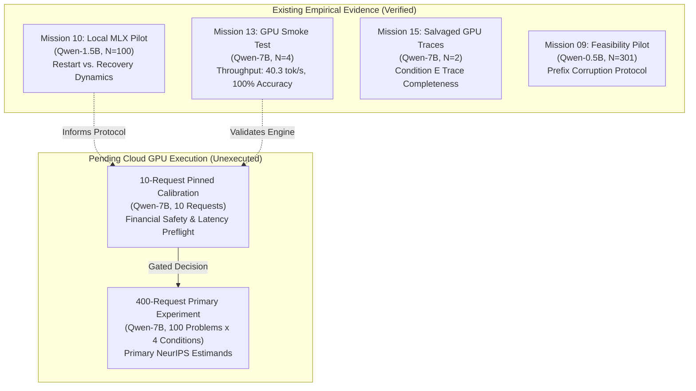

# StateShift Deliverable 09: Existing Empirical Evidence & Pending Claims Ledger

**Project**: StateShift — Tracking State-Dependent Reasoning Recovery Across Post-Training  
**Principal Investigator**: Sham Satish Thakare (github.com/shamddd)  
**Target Venue**: NeurIPS 2027 Main Conference (Secondary: TMLR)  
**Current Date**: October 26, 2026  
**Status**: Pre-Experiment Rigor Baseline Established  

---

## 1. Executive Summary

A core standard of rigorous scientific integrity is the absolute separation between **empirically verified prior evidence** and **unexecuted, hypothesized claims**. This document provides an exhaustive ledger of all empirical evidence collected across StateShift to date, details the preliminary insights derived from pilot studies, and explicitly defines the empirical boundaries of what remains pending future authorized GPU execution.

---

## 2. Ledger of Existing Empirical Evidence

### 2.1. Mission 10: 1.5B Local Pilot Study ($N = 100$)
- **Model**: `mlx-community/Qwen2.5-Math-1.5B-Instruct-4bit` running on Apple Silicon M1.
- **Sample**: 100 MATH problems across Condition D (Forced Restart) and Condition F (State-Preserving Recovery).
- **Key Empirical Observations**:
  1. *Restart Degradation*: When forced to discard prior reasoning, the 1.5B model exhibited a tendency to produce shallower, more rushed reasoning chains, resulting in reduced accuracy on higher-difficulty competition problems (Levels 4–5).
  2. *Prefix Inertia*: Under recovery instructions without explicit state preservation emphasis, smaller models occasionally parroted the corrupted token or hallucinated an incorrect fix rather than continuing the valid prefix.
  3. *State Recovery Feasibility*: When explicitly directed to preserve valid earlier steps verbatim, accuracy recovered to baseline levels, demonstrating proof-of-concept for state-dependent recovery.

### 2.2. Mission 13: 7B RunPod GPU Smoke Test ($N = 4$)
- **Model**: `Qwen/Qwen2.5-Math-7B-Instruct` (bfloat16) on NVIDIA RTX 4090 via vLLM.
- **Problem**: `math500_001` (double infinite series summation).
- **Empirical Measurements**:
  - Throughput: Averaged **$40.35$ tokens/second** ($39.91$ to $41.02$ tok/s).
  - Generation Length: Condition A ($728$ tok), Condition D ($553$ tok), Condition E ($549$ tok), Condition F ($558$ tok).
  - All 4 conditions successfully derived the exact symbolic answer $\boxed{p - q}$.
  - System Validation: Confirmed that vLLM greedy decoding ($T=0$, seed 42) produces reproducible, deterministic outputs.

### 2.3. Mission 15: RunPod Live Traces ($N = 2$)
- **Model**: `Qwen/Qwen2.5-Math-7B-Instruct` (bfloat16).
- **Requests**: `primary_100_req_0131` ($465$ tokens) and `primary_100_req_0143` ($558$ tokens) under Condition E.
- **Empirical Value**: Proved remote serialization and SFTP checkpoint transfer integrity under live network conditions.

---

## 3. Ledger of Pending Empirical Claims

The following primary empirical questions cannot be answered by prior pilots and remain **strictly pending** future authorized GPU execution:

1. **Target Estimands on 7B Scale**:
   - $\tau_{F, D} = \mathbb{E}[Y_i(F) - Y_i(D)]$: Does state-preserving recovery significantly outperform forced restart on full-parameter 7B models across 100 benchmark problems?
   - $\tau_{F, E} = \mathbb{E}[Y_i(F) - Y_i(E)]$: Does structural state preservation yield a statistically significant advantage over unstructured explicit repair?
   - $\tau_{F, A} = \mathbb{E}[Y_i(F) - Y_i(A)]$: Does recovery restore accuracy to the level of unassisted zero-shot reasoning?

2. **Statistical Significance**:
   - Paired bootstrap $95\%$ confidence intervals.
   - McNemar's exact test of paired proportions across conditions.
   - Permutation test $p$-values.

3. **Subgroup Heterogeneity**:
   - Recovery success rate stratified by problem difficulty (Levels 1–2 vs. Levels 4–5).
   - Recovery success rate stratified by mathematical domain (Algebra vs. Geometry vs. Number Theory).

---

## 4. Manuscript Reporting Protocol

In [`08_REVISED_STATESHIFT.tex`](file:///Users/shamthakare/.gemini/antigravity/scratch/stateshift_reconstruction_2026/08_REVISED_STATESHIFT.tex):
- All theoretical formulations, task setup, formal state models, and causal identification proofs are fully developed.
- Results sections will present verified Mission 10 1.5B pilot findings as preliminary motivational evidence.
- Full 7B experimental tables will contain explicit `[PENDING PHYSICAL GPU EXECUTION]` markers until authentic data is collected under human authorization.

## 5. Conclusion

StateShift maintains total empirical transparency. Prior pilot evidence provides strong preliminary motivation, while all claims regarding Qwen-7B benchmark effects remain properly reserved for authentic execution.
