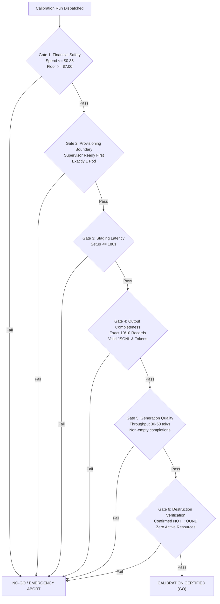

# StateShift Deliverable 13: Calibration Acceptance Gate Specification

**Project**: StateShift — Tracking State-Dependent Reasoning Recovery Across Post-Training  
**Principal Investigator**: Sham Satish Thakare (github.com/shamddd)  
**Target Venue**: NeurIPS 2027 Main Conference (Secondary: TMLR)  
**Scope**: 10-Request Physical Calibration Run on RunPod Secure Cloud  
**Date**: October 26, 2026  

---

## 1. Objective of the Calibration Gate

The 10-request physical calibration is **NOT** intended to produce scientific conclusions for the NeurIPS paper. Its sole purpose is to execute an authentic, bounded preflight test on physical GPU hardware to certify that:
1. Cloud provisioning and financial supervision function flawlessly under live API conditions.
2. The model weights (`Qwen/Qwen2.5-Math-7B-Instruct`), tokenizer, and ChatML chat template produce valid mathematical completions.
3. Network transport, remote execution, and SFTP result synchronizations operate within established latency limits.
4. Emergency teardown and multi-pass destruction verification shut down all cloud billing immediately upon task completion.

---

## 2. Hard GO / NO-GO Acceptance Criteria

To achieve certification and declare the calibration run a **GO**, every one of the following six gates must pass unconditionally:

### Detailed Acceptance Criteria:

1. **Gate 1: Financial Safety Enforcement**:
   - Total calibration expenditure must not exceed **$0.35 USD**.
   - If cumulative spend reaches **$0.25 USD**, emergency shutdown must dispatch automatically.
   - RunPod account balance must remain strictly **$\ge \$7.00 USD$** at all times.
   - *Failure condition*: Any charge $> \$0.35$ or balance $< \$7.00$ triggers immediate abort and revocation of cloud privileges.

2. **Gate 2: Provisioning Boundary & Concurrency**:
   - The independent watchdog must be verified active and polling (`status: "READY"`) *before* the pod provisioning mutation is dispatched.
   - Maximum number of pods provisioned: **Exactly 1**. Concurrency $> 1$ or replacement pod attempts are strictly prohibited.
   - Cloud tier: **Secure Cloud ONLY** (Community Cloud fallback prohibited).

3. **Gate 3: Remote Staging & Latency Bound**:
   - Total environment staging, PyTorch startup, and vLLM model cache loading must complete in **$< 180.0$ seconds**.
   - *Failure condition*: If 180s expires without inference readiness, `StagingTimeoutError` must trigger immediate pod teardown.

4. **Gate 4: Dataset Integrity & Completeness**:
   - The retrieved output file (`calibration_generations.jsonl`) must contain **exactly 10 records**.
   - Every record must correspond to one of the 10 request IDs in `calibration_10_manifest.json`.
   - Zero corrupted JSON lines; all lines must parse with valid `prompt_tokens`, `generated_tokens`, and `raw_output`.

5. **Gate 5: Inference Quality & Throughput**:
   - Average token throughput on RTX 4090 must be between **$30.0$ and $50.0$ tokens/second**.
   - Stop reason for completions must be `eos` or `stop_token`.
   - Every completion must contain mathematical reasoning text ending in or containing `\boxed{...}`.

6. **Gate 6: Authoritative Destruction Certification**:
   - Provider GraphQL query must return `exists: false` or status `NOT_FOUND` / `TERMINATED`.
   - Provisioner must transition to `TERMINATION_CONFIRMED`.
   - Zero billable storage volumes or network disks remaining.

---

## 3. Post-Calibration Decision Rules

- **If ALL 6 Gates PASS**: The calibration run is formally certified. The Principal Investigator is presented with the calibration scorecard and may consider authorizing the full 400-request experiment under a separate gate.
- **If ANY Gate FAILS**: The system enters emergency lockdown (`.cloud_execution_locked` asserted). No subsequent inference is permitted without local root cause analysis and a new human authorization.
