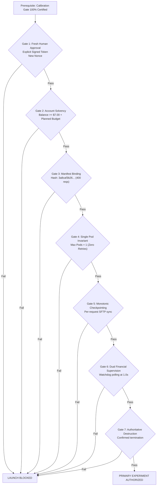

# StateShift Deliverable 14: Full Experiment Acceptance Gate Specification

**Project**: StateShift — Tracking State-Dependent Reasoning Recovery Across Post-Training  
**Principal Investigator**: Sham Satish Thakare (github.com/shamddd)  
**Target Venue**: NeurIPS 2027 Main Conference (Secondary: TMLR)  
**Scope**: 400-Request Primary Experiment (`primary_100_manifest.json`)  
**Target Hardware**: Exactly 1x NVIDIA RTX 4090 (24 GB VRAM), RunPod Secure Cloud  
**Date**: October 26, 2026  

---

## 1. Executive Summary

The 400-request experiment represents the definitive empirical foundation for the StateShift NeurIPS 2027 submission. Because it requires multi-hour GPU execution, it is subject to a strict two-stage gate. Under no circumstances can the full experiment be launched without:
1. Prior 100% certification of the 10-request physical calibration gate (Deliverable 13).
2. Explicit, fresh cryptographic authorization by the Principal Investigator.
3. Verified account solvency above the $7.00 account preservation floor.

---

## 2. Seven Mandatory Acceptance Gates for Full Execution

### Gate Specifications:

1. **Gate 1: Separate Human Authorization & Single-Use Nonce**:
   - The Principal Investigator must issue a new signed Ed25519 authorization document.
   - Pinned parameters:
     - `authorized_mode`: `"PRODUCTION"`
     - `manifest_sha256`: `3a8caf3b26b69cd2d9e3ce3efed1231755edebb0cb2b4067b47a6b019014307d`
     - `model_id`: `Qwen/Qwen2.5-Math-7B-Instruct`
     - `model_revision`: `ef9926d75ab1d54532f6a30dd5e760355eb9aa4d`
     - `max_incremental_spend_usd`: `$2.50`
     - `emergency_trigger_usd`: `$2.00`
     - `minimum_account_balance_usd`: `$7.00`
     - `session_nonce`: Fresh 128-bit cryptographic nonce (never before used).

2. **Gate 2: Account Solvency & Financial Buffer**:
   - Current RunPod balance must satisfy:
     $$\text{Balance} \ge \text{Account Preservation Floor} + \text{Planned Spend} = \$7.00 + \$2.50 = \$9.50 \text{ USD}$$
   - If the account balance is below $\$9.50$, launching the full 400-request experiment is prohibited until funds are replenished.

3. **Gate 3: Compute & Time Budget Feasibility**:
   - Total workload: 400 requests $\times$ 550 tokens $\approx$ 220,000 tokens.
   - At certified rate ($\ge 40$ tok/s):
     $$\text{Execution Time} \approx \frac{220,000}{40} = 5,500 \text{ seconds} \approx 1.53 \text{ hours}$$
   - At RTX 4090 Secure Cloud rate ($0.89/hr):
     $$\text{Expected Cost} \approx 1.53 \times \$0.89 \approx \$1.36 \text{ USD}$$
   - Planned budget ($2.50) provides an 84% buffer against variance in generation length.

4. **Gate 4: Single-Pod Concurrency Invariant**:
   - Exactly ONE pod is provisioned. Automated retries or duplicate pod allocations are locked out by `SupervisorFirstProvisioner`.

5. **Gate 5: Monotonic Checkpointing & Safe Resume**:
   - Completed generations must be appended to `primary_100_generations.jsonl` and flushed to disk incrementally after every single request.
   - If an SSH disconnection occurs, `SafeResumeReconciler` verifies the remote execution PID and resumes from the exact next manifest index ($k+1$) without duplicate generation.

6. **Gate 6: Dual Financial Supervision**:
   - Independent watchdog process runs continuously, reconciling effective spend against the $2.00 emergency trigger and the $7.00 balance floor every 1.0 second.

7. **Gate 7: Authoritative Teardown Verification**:
   - Upon completion of request 400, emergency teardown issues pod destruction and performs multi-pass verification until status is `NOT_FOUND` or `TERMINATED`.

---

## 3. Conclusion

This acceptance gate guarantees that the full 400-request experiment can proceed only when technical readiness, financial safety, and cryptographic authorization are fully aligned.
