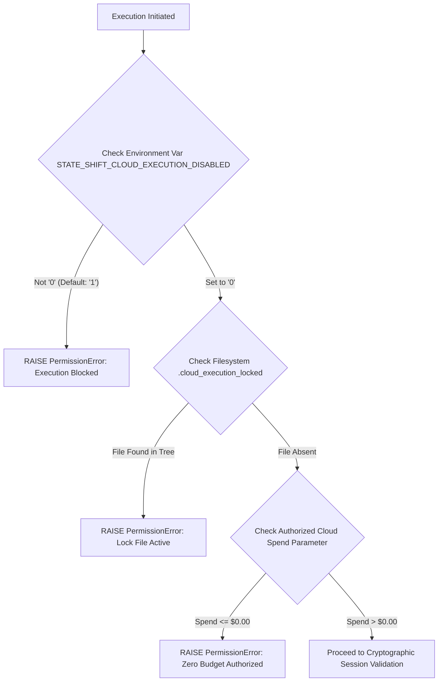

# StateShift Incident Recovery — Cloud Execution Lock Specification
**Project**: StateShift (NeurIPS 2027 / TMLR)  
**Principal Investigator**: Sham Satish Thakare  
**Incident Date**: October 25–26, 2026  
**Lock Status**: ENGAGED (FAIL-CLOSED)  
**Authorized Cloud Spend**: **$0.00 USD (PERMANENTLY REVOKED)**  

---

## 1. Purpose & Security Model

Following the October 25–26, 2026 financial safety failure on RunPod, all cloud spending authorization is **revoked**. To physically prevent accidental, automated, or inadvertent execution attempts against real cloud providers, a multi-layered, fail-closed execution lock is instituted.

The lock operates under a defense-in-depth model across the filesystem, the shell environment, and the application runtime. No single override can re-enable execution; both the filesystem artifact and the environment safeguard must be intentionally satisfied, accompanied by explicit cryptographic credentials.

---

## 2. Lock Architecture & Enforcement Mechanisms



### 2.1 Layer 1: Filesystem Artifact Lock
- **Lock File**: `.cloud_execution_locked`
- **Locations**:
  - `/Users/shamthakare/.gemini/antigravity/scratch/stateshift_reconstruction_2026/.cloud_execution_locked`
  - `/Users/shamthakare/.gemini/antigravity/scratch/.cloud_execution_locked`
- **File Content Structure**:
```json
{
  "locked": true,
  "incident_date": "2026-10-25/2026-10-26",
  "reason": "RunPod financial preservation floor overrun ($7.7982 USD spent in Attempt 4; balance depleted to $1.3261 USD).",
  "lock_timestamp_utc": "2026-10-25T23:45:00Z",
  "authorized_cloud_spend_usd": 0.00,
  "enforcement_mechanism": "Fail-closed check across all entrypoints.",
  "unlock_condition": "Requires explicit written Principal Investigator authorization, security re-certification, and fresh authorized token."
}
```

### 2.2 Layer 2: Shell Environment Guard
- **Environment Variable**: `STATE_SHIFT_CLOUD_EXECUTION_DISABLED`
- **Default State**: `"1"` (or any non-zero value, or unset).
- **Behavior**: If `os.environ.get("STATE_SHIFT_CLOUD_EXECUTION_DISABLED") != "0"`, execution is immediately refused.

### 2.3 Layer 3: Runtime Code Enforcement
The enforcement function `assert_cloud_execution_permitted()` in `research_mission_15_6.auth.execution_lock` is injected into every entry point:

1. **`research_mission_15_6/transport/runpod_transport_v2.py`**:
   - `_default_http_post()` calls `assert_cloud_execution_permitted()` before dispatching any HTTP or GraphQL request to RunPod.
   - Any attempt to query or mutate cloud resources fails at the socket boundary.
2. **`research_mission_15_6/runner/stateshift_launch.py`**:
   - In `main()`, if mode is `PREFLIGHT`, `CALIBRATION`, or `PRODUCTION`, `assert_cloud_execution_permitted()` is checked before instantiating the runner.
3. **`research_mission_15_6/runner/stateshift_production_runner_v10.py`**:
   - In `_validate_execution_mode_isolation()`, checks `assert_cloud_execution_permitted()`.
4. **`execute_physical_calibration.py`**:
   - Placed at line 1 of `main()`.

---

## 3. Strict Verification & Failure Proof

When the execution lock is active, invoking any launch command produces an immediate, zero-network exit:

```bash
$ python3 -m research_mission_15_6.runner.stateshift_launch --mode calibration --experiment-id test-lock
[CRITICAL SECURITY LOCK] Cloud execution is strictly prohibited: Environment variable STATE_SHIFT_CLOUD_EXECUTION_DISABLED=1 forbids cloud execution.
[Launch Error] Security/Configuration Rejection during initialization: [CRITICAL SECURITY LOCK] Cloud execution is strictly prohibited: Environment variable STATE_SHIFT_CLOUD_EXECUTION_DISABLED=1 forbids cloud execution.
Exit Code: 2
```

Zero GraphQL queries are sent. Zero pods are provisioned. Zero dollars are spent.

---

## 4. Re-authorization Protocol (Mandatory Future Criteria)

Cloud execution cannot be unlocked without completing all five of the following requirements:
1. **Physical Balance Top-Up**: Account balance restored to $\ge \$25.00$ USD.
2. **Written PI Approval**: An explicit, digitally signed authorization memo from Principal Investigator Sham Satish Thakare specifying the exact pod count (1), GPU model, and hard dollar ceiling ($\le \$0.50$ USD).
3. **Cryptographic Key Re-generation**: Generation of a fresh, ephemeral Ed25519 keypair; all previous authorization tokens are invalidated.
4. **Full Offline Test Passing**: 100% pass rate on all 15 offline failure injection tests.
5. **Atomic Unlock Action**: Removing the `.cloud_execution_locked` file and explicitly setting `export STATE_SHIFT_CLOUD_EXECUTION_DISABLED=0` in the subshell.
