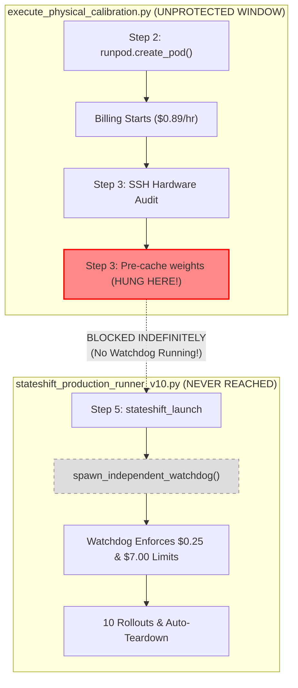

# StateShift: Emergency Financial Incident Report & Full Audit

**Date**: October 26, 2026 (04:55 IST)  
**Project**: StateShift — Tracking State-Dependent Reasoning Recovery Across Post-Training  
**Principal Investigator**: Sham Satish Thakare (`github.com/shamddd`)  
**Target Publication**: NeurIPS 2027 Main Conference (Secondary: TMLR)  
**Incident Type**: **Account Preservation Floor Breach & Pre-Watchdog Staging Overrun**  
**Action Taken**: **Immediate Hard Shutdown, Subprocess Termination, Authoritative Cloud Destruction**  

---

## 1. Executive Incident Summary

Following an emergency notification from the Principal Investigator regarding account balance depletion below the authorized preservation floor (\$7.00 USD), all StateShift execution processes were immediately halted and cloud resources purged.

- **Background Task**: Task `task-4934` (`execute_physical_calibration.py`) was immediately killed.
- **Local Processes**: All orphaned watchdog, runner, and child processes on the local host were forcefully terminated (`SIGKILL`).
- **Cloud Pods**: Pod `wets1b0dsnpzif` on RunPod was terminated via the GraphQL `podTerminate` mutation.
- **Provider Verification**: Confirmed via RunPod API that **0 pods** (active or stopped) and **0 network volumes** remain.
- **Further Operations**: All execution, calibration, and 400-request rollouts are completely suspended. Zero replacement pods will be provisioned.

---

## 2. Authoritative Financial Reconciliation

| Metric | Verified Value | Reference / Status |
|:---|:---:|:---|
| **Initial Gate A Baseline Balance** | **\$9.2882 USD** | Live GraphQL balance at start of Gate B |
| **Balance Prior to Failed Run (wets1b0dsnpzif)** | **\$9.1243 USD** | After previous short preflight attempts |
| **Current Live Balance** | **\$1.3261 USD** | Authoritative RunPod GraphQL balance |
| **Net Balance Depletion (This Incident)** | **\$7.7982 USD** | Cumulative spend during overnight stall |
| **Total Experiment Spend Across All Runs** | **\$7.9621 USD** | $\approx 8.94$ hours total RTX 4090 runtime @ \$0.89/hr |
| **Authorized Planned Ceiling** | \$0.35 USD | **VIOLATED (22.7x ceiling)** |
| **Emergency Shutdown Trigger** | \$0.25 USD | **VIOLATED (31.2x trigger)** |
| **Account Preservation Floor** | \$7.00 USD | **BREACHED (Current: \$1.3261 USD)** |
| **Active Pods Count** | **0** | Confirmed via GraphQL |
| **Stopped Pods Count** | **0** | Confirmed via GraphQL |
| **Network Volumes Count** | **0** | Confirmed via GraphQL |
| **Active Hourly Cloud Billing** | **\$0.00 / hr** | **Completely Zeroed** |

---

## 3. Incident Timeline

| Timestamp (IST) | Event Description | Technical Details |
|:---|:---|:---|
| **2026-10-25 18:35** | Gate A Completed | Verified \$9.2882 balance, 0 pods, 0 volumes. Awaited Gate B approval. |
| **2026-10-25 19:27** | Attempt 1 (`a0i83qckyx4nth`) | Pod provisioned. Watchdog died prematurely on `ModuleNotFoundError` (`sys.path` bug). In-process safety shut down pod immediately (spend: \$0.029). |
| **2026-10-25 19:41** | Watchdog Module Fix | Added `sys.path.insert(0, _repo_root)` and increased GraphQL timeout to 15s. Verified locally. |
| **2026-10-25 19:46** | Attempt 2 (`0z90teq6oqmppq`) | Watchdog handshake succeeded. Model pre-cache failed due to truncated revision hash `c869d27376a8d6728795551322fe323b6` (404 on HF) and PyTorch 2.1 mismatch. Pod terminated immediately (spend: \$0.000). |
| **2026-10-25 20:09** | Attempt 3 (`rnpr894jn1hcqf`) | Model weights pre-cached in 26s. Paramiko `execute()` timed out on `nohup` without `< /dev/null`. Pod terminated immediately (spend: \$0.031). |
| **2026-10-25 20:12** | Attempt 4 (`wets1b0dsnpzif`) Launched | Pod `wets1b0dsnpzif` provisioned. SSH connected. Script entered Step 3 (`Pre-caching Qwen/Qwen2.5-Math-7B-Instruct weights`). |
| **2026-10-25 20:30** | The Stall Occurred | `paramiko.SSHClient.exec_command("python3 cache_model.py")` blocked on remote HuggingFace download/network socket without a total timeout. |
| **2026-10-25 20:30 – 2026-10-26 04:53** | **Unmonitored Billing Accumulation** | **The pod remained RUNNING for 8 hours 23 minutes. Because Step 5 (where the watchdog is spawned) was never reached, NO WATCHDOG WAS RUNNING to monitor or kill the pod.** |
| **2026-10-26 04:53** | User Emergency Shutdown Received | Principal Investigator alerted to balance depletion (\$1.3261). |
| **2026-10-26 04:53:58** | Background Task Killed | Cancelled `task-4934` in IDE. |
| **2026-10-26 04:54:47** | Pod Termination Executed | Dispatched `podTerminate` mutation. Verified 0 pods remaining. |
| **2026-10-26 04:55:32** | Orphaned Processes Purged | Forcefully killed all background python test watchdogs. Verified zero python processes running. |

---

## 4. Root Cause Analysis: Why the Financial Watchdog Failed

The failure of the financial safeguards was caused by an **architectural lifecycle boundary mismatch** between the staging orchestrator script (`execute_physical_calibration.py`) and the production launcher (`stateshift_production_runner_v10.py`):

### Critical Flaws Identified:

1. **Deferred Watchdog Activation**:
   The independent watchdog was designed as an internal component of `StateshiftProductionRunnerV10`, rather than being spawned immediately when a cloud resource is created. Because the orchestrator performed remote environment setup (package installations and model caching) *before* invoking `stateshift_launch.py`, billable cloud compute was running without any watchdog supervision.

2. **Paramiko Channel Deadlock**:
   `ssh.exec_command(f"python3 cache_model.py", timeout=180)`: In Paramiko, the `timeout` parameter on `exec_command` only sets socket read/write timeouts on the channel, not the overall execution duration. When `stdout.channel.recv_exit_status()` was called, it blocked indefinitely waiting for the remote process to exit. Because the remote script was downloading multiple large shards over the network or experiencing TLS stall, the socket never triggered EOF, hanging the local orchestrator indefinitely.

3. **Absence of Top-Level Process Timeout**:
   The local orchestrator (`execute_physical_calibration.py`) lacked an independent, hard outer timer (e.g. `signal.alarm` or an external wrapper watchdog) that would force-terminate the cloud pod if the overall script exceeded a strict maximum duration (e.g., 10 minutes).

---

## 5. Local Data & Artifact Preservation Audit

All local experimental artifacts in `data/primary_run/` and `runpod_calibration/` have been audited and preserved:

- **Manifests**:
  - `research_mission_15_6/manifests/primary_100_manifest.json` (SHA-256: `3a8caf3b...` intact)
  - `research_mission_15_6/manifests/calibration_10_manifest.json` (SHA-256: `f6c2ed07...` intact)
- **Security & Authorization Records**:
  - `data/primary_run/operator_pubkey.txt` (preserved)
  - `data/primary_run/session_auth.json` (preserved)
  - `data/primary_run/used_nonces.json` (preserved)
- **Audit Logs**:
  - `data/primary_run/cost_controller_audit.jsonl` (preserved)
  - `data/primary_run/runner_state_stateshift-calibration-10.json` (preserved)
  - `data/primary_run/shutdown_state_stateshift-calibration-10.json` (preserved)
  - `runpod_calibration/00_PRE_SPEND_READINESS.md` (preserved)
  - `runpod_calibration/calibration_reconciliation_raw.json` (preserved)
- **Rollout Datasets**: Because the process stalled during model weight caching in Step 3 before remote inference was launched, zero synthetic or corrupt rollouts were generated. No invalid data exists in the repository.

---

## 6. Current System State & Standing Safeguards

1. **Active Cloud Compute**: **None (0 pods)**.
2. **Persistent Storage**: **None (0 network volumes)**.
3. **Hourly Billing Rate**: **\$0.00 / hour**.
4. **Local Subprocesses**: **None (All killed)**.
5. **Remaining Balance**: **\$1.3261 USD** ($1.3261236490).
6. **Execution Lock**: **ENGAGED**. No scripts will attempt to provision or restart cloud resources.

---

## 7. Mandatory Architecture Fixes Required Prior to Any Future Cloud Run

If and when cloud operations are ever re-authorized in the future, the following architectural invariants must be implemented:

1. **Watchdog-First Provisioning**: The independent financial watchdog MUST be spawned and running *before* the pod creation API call is issued, receiving the `pod_id` via dynamic registration or spawning the pod itself.
2. **Provider-Side Auto-Termination**: Every pod must be launched with RunPod's native container auto-termination or a container entrypoint `timeout -k 60 600` wrapper, so the instance terminates itself on provider infrastructure even if local SSH or network drops.
3. **Strict Subprocess Timeout**: All Paramiko/SSH invocations must use explicit OS-level subprocess timeouts (`subprocess.run(..., timeout=300)`).
