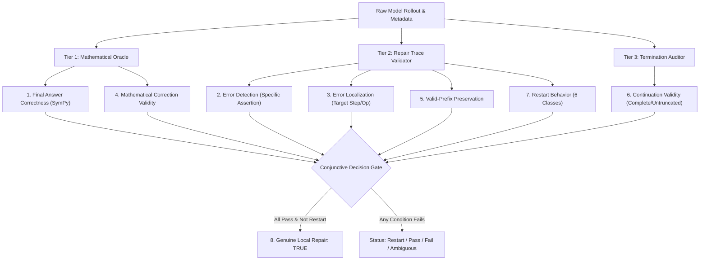

# 02. Mathematical Recovery Evaluator Specification (v3)

**Project**: StateShift: Tracking State-Dependent Reasoning Recovery Across Post-Training  
**Author**: Sham Satish Thakare (`github.com/shamddd`)  
**Target Venue**: NeurIPS 2027 Main Conference (Primary) | TMLR (Secondary)  
**Date**: October 2026  
**Module**: [`evaluation/strict_recovery_evaluator_v3.py`](file:///Users/shamthakare/.gemini/antigravity/scratch/stateshift_reconstruction_2026/research_mission_11/evaluation/strict_recovery_evaluator_v3.py)  

---

## 1. Architectural Motivation & Flaws Resolved

The Mission 10 evaluator suffered from fundamental vulnerabilities:
1. **Keyword-Triggered Classification**: Labeled error detection based on words like `"error"`, `"mistake"`, `"wait"`.
2. **Conflation of Restarts**: Failed to detect *implicit restarts*, where the model re-stated the problem from Step 1 and solved de novo.
3. **Presumption of Preservation**: Assumed any non-empty string that lacked restart keywords preserved the prefix.
4. **Heuristic Truncation**: Used crude character lengths rather than actual generation token limits.

Evaluator v3 replaces all heuristics with a 3-tier modular architecture:
- **`MathematicalOracle`**: Exact SymPy symbolic equivalence, fraction arithmetic, interval checks, and algebraic verification.
- **`RepairTraceValidator`**: Injected step localization, prefix continuity checking, and 6-class restart taxonomy.
- **`GenerationTerminationAuditor`**: Real backend token counter limits and termination stop reason verification.

---

## 2. The 8 Orthogonal Evaluation Dimensions

### Dimension Definitions & Mathematical Criteria

| Dimension | Verification Mechanism | Success Criterion | Failure Modes Blocked |
| :--- | :--- | :--- | :--- |
| **1. Final Answer Correctness** | `MathematicalOracle.verify_symbolic_equivalence` | $\text{pred} \equiv \text{gold}$ via SymPy simplify / exact fractions. | Formatted string differences, fraction representations. |
| **2. Error Detection** | `RepairTraceValidator.evaluate_error_localization` | Must explicitly assert a mathematical flaw referencing a specific calculation. | Mere conversational hedging ("actually", "wait"). |
| **3. Error Localization** | Structured pattern matching on step indices and flawed algebraic terms. | Must point to the injected step $k$ or targeted operator expression. | Vague assertions that "an error exists somewhere". |
| **4. Correction Validity** | `MathematicalOracle.verify_assertion_validity` | The corrected equation $A = B$ is algebraically and numerically true. | Hallucinated corrections that introduce new errors. |
| **5. Prefix Preservation** | Token overlap and contradiction exclusion. | Valid prefix up to step $k-1$ is retained; no contradictory variable setups. | Implicit restarts, redefining problem parameters. |
| **6. Continuation Validity** | Backend metadata verification. | Model does NOT hit `max_tokens`; cleanly extracts final answer. | Premature truncation, mid-derivation cutoff. |
| **7. Restart Behavior** | 6-class classification. | Must classify as `LOCAL_REPAIR` or `PARTIAL_RECOMPUTATION`. | Implicitly re-solving from step 1 labeled as repair. |
| **8. Genuine Local Repair** | Conjunctive boolean product. | $\bigwedge_{i=1}^6 D_i \land (D_7 \notin \{\text{Explicit, Implicit}\})$. | "Lucky guesses", superficial post-hoc comments. |

---

## 3. The 6-Class Restart & Trace Taxonomy

1. **`EXPLICIT_RESTART`**: Output explicitly states intention to discard prior derivation (*"Let's start over from scratch"*).
2. **`IMPLICIT_RESTART`**: Output begins by re-stating the initial problem statement or step 1 definition (*"To compute 99^2 + 99 + 1, we begin by..."*) and derives the solution de novo.
3. **`LOCAL_REPAIR`**: Output begins directly at the corrupted step, identifies the flaw, corrects it surgically, and proceeds.
4. **`PARTIAL_RECOMPUTATION`**: Output re-checks only the immediate preceding step before continuing.
5. **`BLIND_COPYING`**: Output uncritically accepts the corrupted mathematical assertion and propagates it into subsequent calculations.
6. **`AMBIGUOUS_BEHAVIOR`**: Output contains contradictory or unparseable structural flow.

---

## 4. Conjunctive Gate for Genuine Local Repair

A rollout is certified as **Genuine Local Repair** if and only if:
$$\text{GenuineLocalRepair} = D_1 \land D_2 \land D_3 \land D_4 \land D_5 \land D_6 \land (D_7 = \text{"LOCAL\_REPAIR"})$$

If any term evaluates to `False`, the response is classified into its descriptive category:
- `RESTART_SUCCESS`: Correct final answer via explicit or implicit restart.
- `LUCKY_GUESS_OR_PASSIVE_PASS`: Correct final answer without error detection or explicit repair.
- `FAILED_LOCAL_REPAIR`: Error detected, but repair invalid or final answer wrong.
- `BLIND_COPYING_PROPAGATION`: Flawed assertion propagated to conclusion.
- `UNVERIFIED_OR_AMBIGUOUS`: Inconclusive trace.
