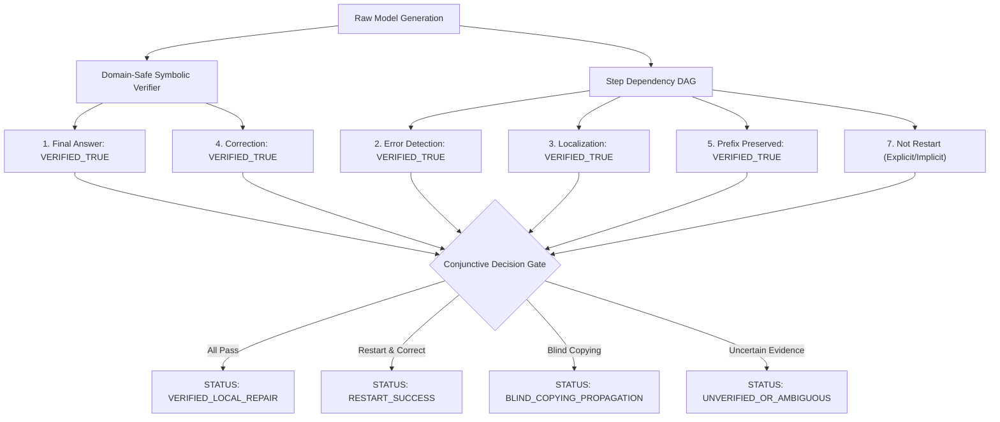

# 02. Mathematical Recovery Evaluator Specification (v4)

**Project**: StateShift: Tracking State-Dependent Reasoning Recovery Across Post-Training  
**Author**: Sham Satish Thakare (`github.com/shamddd`)  
**Target Venue**: NeurIPS 2027 Main Conference (Primary) | TMLR (Secondary)  
**Date**: October 2026  
**Module**: [`evaluation/strict_recovery_evaluator_v4.py`](file:///Users/shamthakare/.gemini/antigravity/scratch/stateshift_reconstruction_2026/research_mission_12/evaluation/strict_recovery_evaluator_v4.py)  

---

## 1. Architectural Principles of Evaluator v4

Evaluator v4 was engineered to address every vulnerability identified in the Adversarial Audit of Evaluator v3:

1. **Elimination of Keyword Traps**:
   Error detection and localization require explicit evidence that the model challenges or corrects the specific corrupted assertion. Merely stating *"I found an error"* without locating the actual flawed line evaluates to `VERIFIED_FALSE`. Conversely, a surgical algebraic correction without conversational error words evaluates to `VERIFIED_TRUE`.
2. **4-Valued Categorical Labels**:
   Every dimension returns one of four formal states:
   - `VERIFIED_TRUE`: Definitively proven by symbolic/exact mathematical verification.
   - `VERIFIED_FALSE`: Definitively contradicted by mathematical verification.
   - `UNVERIFIED`: Evidence is incomplete, ambiguous, or symbolic solver timed out.
   - `NOT_APPLICABLE`: Dimension does not apply to this experimental condition (e.g. prefix preservation in zero-shot).
3. **Structured Schema & Dependency Graph**:
   Operates on `StructuredProblemCase`, tracking `valid_prefix_steps`, `corrupted_step_id`, `corrupted_assertion`, and `expected_corrected_assertion`.
4. **Non-Mutually-Exclusive Restart Behaviors**:
   Instead of forcing a single label, Evaluator v4 records multi-behavior flags:
   - `is_explicit_restart`
   - `is_implicit_restart`
   - `is_local_repair`
   - `is_partial_recompute`
   - `is_blind_copying`
5. **Traceable Textual Evidence Spans**:
   Every verdict includes the exact substring of model generation justifying the classification.

---

## 2. Conjunctive Decision Gate for Genuine Local Repair

A generation is certified as **Genuine Local Repair** if and only if:
$$\text{GenuineRepair} = \left(\text{Ans} = \text{VERIFIED\_TRUE}\right) \land \left(\text{Detect} = \text{VERIFIED\_TRUE}\right) \land \left(\text{Loc} = \text{VERIFIED\_TRUE}\right) \land \left(\text{Corr} = \text{VERIFIED\_TRUE}\right) \land \left(\text{Pfx} = \text{VERIFIED\_TRUE}\right) \land \left(\text{Cont} = \text{VERIFIED\_TRUE}\right) \land \neg\text{Restart}$$

If any required antecedent is `UNVERIFIED` or `VERIFIED_FALSE`, the overall status cannot be `VERIFIED_LOCAL_REPAIR`.

