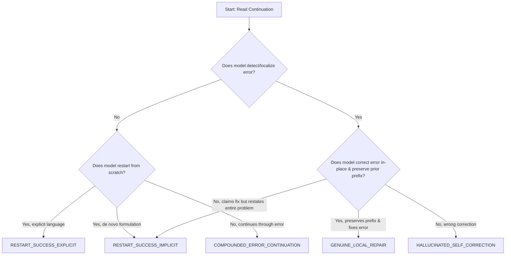

# Research Mission 15: Double-Blind Human Validation Protocol

**Principal Investigator**: Sham Satish Thakare  
**Repository**: `github.com/shamddd/stateshift`  
**Target Venue**: NeurIPS 2027 Main Conference (Secondary: TMLR)  
**Deliverable**: `research_mission_15/06_HUMAN_VALIDATION_PROTOCOL.md`  
**Status**: Formal Pre-Registration of Human Evaluation Standard  
**Date**: October 25, 2026  
**Auditor**: Independent Scientific Methodology Specialist  

---

## 1. Context and Objective

An audit in Mission 14 revealed that the preliminary "60-trace human validation packet" contained zero actual human labels and was formally classified as **HUMAN VALIDATION PENDING**.

For NeurIPS 2027, automated evaluation alone (even symbolic verifiers like Evaluator v5.1) cannot serve as the sole ground truth for behavioral classifications like "local repair" vs "implicit restart." Reviewers legitimately demand gold-standard human calibration.

This document establishes the **double-blind, multi-annotator protocol** to calibrate and validate Evaluator v5.1 against expert human judgment.

---

## 2. Statistical Power and Sample Sizing

To estimate the true agreement rate $P_a$ between Evaluator v5.1 and human experts with a confidence level of $95\%$ and a margin of error $E \le \pm 0.05$ (assuming expected agreement $P_a \approx 0.90$):

$$N = \frac{Z^2 \cdot P_a (1 - P_a)}{E^2} = \frac{(1.96)^2 \cdot (0.90)(0.10)}{(0.05)^2} = \frac{3.8416 \cdot 0.09}{0.0025} \approx 138.3$$

### Formal Cohort Sizing:
- **Total Calibration Sample**: Exactly $N = 140$ rollouts sampled uniformly across the 4 conditions:
  - Condition A: 35 rollouts
  - Condition D: 35 rollouts
  - Condition E: 35 rollouts
  - Condition F: 35 rollouts
- **Stratification**: Sampled evenly across problem difficulty levels (MATH Levels 1 through 5) and error operator categories (Arithmetic, Sign Inversion, Formula Confusion, Premature Rounding).

---

## 3. Double-Blind Blinding Protocol

To eliminate confirmation bias and expectations:
1. **Condition Blinding**: Annotators are presented ONLY with:
   - The original mathematical problem statement.
   - The injected prefix (if any).
   - The model's continuation tokens.
   - The verified ground-truth reference answer.
2. **Metadata Redaction**: The following fields are strictly stripped from the annotation packet:
   - Condition name / code (`Condition_A`, `Condition_D`, `Condition_E`, `Condition_F`).
   - Prompt instructions given to the model (e.g. "discard the above", "correct in place").
   - Model name and architecture (`Qwen2.5-Math-7B-Instruct`).
   - Evaluator v5.1 predicted strategy and automated verdicts.
3. **Randomized Presentation**: All 140 rollouts are randomly permuted so rollouts from the same problem or condition do not appear sequentially.

---

## 4. Annotation Rubric and Decision Tree

Each annotator evaluates three binary criteria independently:

### Rubric Definitions:
- **Criterion 1: Error Recognition**: Did the model explicitly identify that an error occurred in the preceding prefix?
- **Criterion 2: Local Repair vs Full Restart**:
  - *Genuine Local Repair*: The model accepts the uncorrupted prefix prior to step $k$, rewires step $k$ with the correct calculation, and continues smoothly forward without repeating steps $1 \dots k-1$.
  - *Implicit Restart*: The model discards the prefix and solves the problem from step 1 de novo without referencing prior work.
  - *Explicit Restart*: The model explicitly states it is restarting ("Let's restart from scratch").
- **Criterion 3: Final Answer Correctness**: Does the boxed answer agree algebraically with the reference solution?

---

## 5. Inter-Annotator Reliability and Agreement Standards

- **Annotator Pool**: Three independent human annotators with graduate-level backgrounds in mathematics, computer science, or machine learning.
- **Metrics Calculated**:
  - Pairwise Cohen's Kappa ($\kappa$):
    $$\kappa = \frac{P_o - P_e}{1 - P_e}$$
  - Multi-rater Fleiss' Kappa ($\kappa_{\text{Fleiss}}$) across all three annotators.
- **Acceptance Threshold**:
  - Pre-registered minimum required agreement: **$\kappa \ge 0.80$** (indicates near-perfect agreement under Landis & Koch, 1977).
  - If $\kappa < 0.80$, annotation guidelines must be revised and a separate cohort re-annotated.
- **Adjudication**: Where two annotators disagree, the third annotator serves as the primary tie-breaker. If all three assign different strategies, a consensus panel convenes to review the trace.

---

## 6. Pre-Registration Commitment

No claims regarding human evaluation agreement will be reported in the manuscript until this double-blind protocol is physically executed with human annotators and formal Cohen's / Fleiss' kappa metrics are computed.
