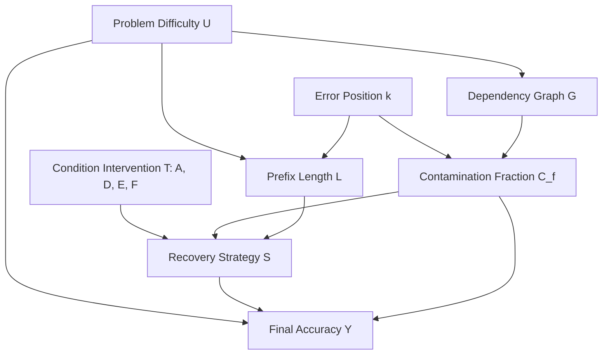

# Research Mission 15: Decisive Causal Experiment Design

**Principal Investigator**: Sham Satish Thakare  
**Repository**: `github.com/shamddd/stateshift`  
**Target Venue**: NeurIPS 2027 Main Conference (Secondary: TMLR)  
**Deliverable**: `research_mission_15/08_DECISIVE_CAUSAL_EXPERIMENT_DESIGN.md`  
**Status**: Decisive Causal Protocol for Post-Training Recovery Analysis  
**Date**: October 25, 2026  
**Auditor**: Causal Inference & Directed Acyclic Graph (DAG) Methodologist  

---

## 1. Executive Summary

Previous missions identified a correlation between high DAG contamination fractions ($C_f$) and reasoning failure. However, an adversarial NeurIPS reviewer would rightly object:
> *"Does high branch contamination cause recovery failure, or is high contamination merely an artifact of early error injection ($k=1$), where any mistake destroys the remainder of the solution?"*

To isolate the genuine causal effect of state corruption and dependency topology, this experiment design defines a **counterfactual intervention framework** that isolates structural DAG contamination from confounding covariates like injection depth $k$, problem difficulty, and token prefix length.

---

## 2. Structural Causal Model & Identification DAG

We represent the reasoning generation and recovery process via the following Directed Acyclic Graph (DAG):

### Unconfounded Identification Strategy:
To identify the direct causal effect of Branch Contamination ($C_f$) on Strategy Selection ($S$) and Accuracy ($Y$), we must block the backdoor path:
$$C_f \leftarrow k \rightarrow L \rightarrow S \rightarrow Y \quad \text{and} \quad C_f \leftarrow G \leftarrow U \rightarrow Y$$

This is achieved by **matched counterfactual pair sampling**:
1. Fix the error injection step $k = 2$ across all paired problems.
2. Fix the prefix token length $L \in [120, 160]$ tokens.
3. Select problem pairs with identical difficulty levels ($U = 3$) where the mathematical proof structure branches into either:
   - **High Contamination Branch ($C_f \ge 0.75$)**: The corrupted lemma is an essential dependency for all subsequent reasoning steps.
   - **Low / Isolated Contamination Branch ($C_f \le 0.25$)**: The corrupted lemma is an independent parallel lemma, leaving the primary derivation chain uncorrupted.

---

## 3. Factorial Manipulation Framework

The decisive experiment crosses **Prompt Intervention ($T$)** with **Causal Branch Contamination ($C_f$)**:

| Factor | Levels | Operational Definition |
| :--- | :---: | :--- |
| **Factor 1: Prompt Intervention ($T$)** | 4 | **$A$ (Clean Zero-Shot)**: Problem statement only. **$D$ (Forced Restart)**: Prefix + discard instruction. **$E$ (Explicit Repair)**: Prefix + localize and repair instruction. **$F$ (Neutral Continuation)**: Prefix + continuous completion instruction. |
| **Factor 2: Dependency Contamination ($C_f$)** | 2 | **High Contamination ($C_f \ge 0.75$)**: Error cascades across all subsequent steps. **Low Contamination ($C_f \le 0.25$)**: Error is restricted to an isolated branch. |
| **Controlled Covariates (Held Constant)** | 3 | **Error Step Index**: $k = 2$. **Problem Difficulty**: Level 3 (Intermediate). **Prefix Length**: $140 \pm 20$ tokens. |

---

## 4. Testable Causal Predictions & Falsification Criteria

This design yields three falsifiable causal predictions:

### Prediction 1: The Branch Isolation Recovery Hypothesis
- **Hypothesis**: If LLMs possess genuine local state repair capacity, recovery rates under Condition E and F will be significantly higher in the Low Contamination regime ($C_f \le 0.25$) than in the High Contamination regime ($C_f \ge 0.75$), holding prefix length and error depth constant:
  $$\mathbb{E}[Y \mid T=E, C_f \le 0.25] - \mathbb{E}[Y \mid T=E, C_f \ge 0.75] > 0$$
- **Falsification**: If recovery rates in Condition E remain at $0.0\%$ regardless of branch contamination, this conclusively falsifies the hypothesis that local repair is blocked merely by downstream cascading dependencies. It proves that the model lacks the fundamental state-tracking capacity to repair even isolated parallel errors.

### Prediction 2: Strategy Invariance Under Prompting
- **Hypothesis**: Condition E prompts the model explicitly to perform in-place repair.
- **Falsification**: If the observed strategy in Condition E is statistically indistinguishable from Condition D (both defaulting 100% to implicit or explicit restarts), then prompt interventions cannot induce state-preserving repair in post-trained mathematical models.

---

## 5. Execution Manifest Separation

To ensure scientific purity:
1. The Primary 100-Problem Manifest (`primary_100_manifest.json`) serves as the unbiased exploratory/confirmatory baseline across natural distributions.
2. The Decisive Causal Manifest (`causal_50_matched_manifest.json`) is maintained as an independent, separately versioned cohort of 50 matched problem pairs (200 requests) designed specifically for causal effect estimation.
3. No GPU execution of this causal cohort is permitted until separate authorization is granted.
