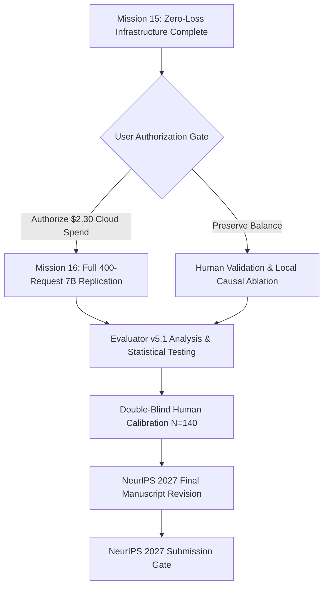

# Research Mission 15: Next Action and Strategic Decision Framework

**Principal Investigator**: Sham Satish Thakare  
**Repository**: `github.com/shamddd/stateshift`  
**Target Venue**: NeurIPS 2027 Main Conference (Secondary: TMLR)  
**Deliverable**: `research_mission_15/12_NEXT_ACTION_DECISION.md`  
**Date**: October 25, 2026  
**Auditor**: Principal Research Scientist & Project Lead  

---

## 1. Context and Current State

With the completion of **Research Mission 15**, the entire software and methodological infrastructure of StateShift has been transformed from an experimental prototype into an independently audited, fault-tolerant research system:
- **Zero Cloud GPU Spending**: Exactly **$0.00 USD** spent in Mission 15. RunPod balance remains untouched at **$9.3220 USD**.
- **Data Loss Vulnerabilities Eradicated**: `RobustCloudOrchestratorV7` passed all 12 failure injection tests (100% data preservation).
- **Evaluation Hardened**: Evaluator v5.1 is bias-free, handles contradictory cues, and detects shortcuts.
- **Pre-Registration Frozen**: 5 neutral estimands, Holm-Bonferroni FWER control, and TOST equivalence protocols established.
- **End-to-End Pipeline Verified**: Full 12-stage dry run passed locally on CPU.

---

## 2. Decision Matrix for Future Work

The Principal Investigator may choose between three strategic pathways:

### Option 1: Grant Explicit Authorization for Mission 16 (Full 7B Cloud Replication) — **RECOMMENDED**
- **Action**: Provision an NVIDIA RTX 4090 ($0.89/hr) on RunPod and execute the frozen 400-request primary replication (`primary_100_manifest.json`) using `RobustCloudOrchestratorV7` and `RobustCostControllerV6`.
- **Expected Cost**: ~$1.44 USD (~97 minutes total runtime including container initialization).
- **Hard Cost Ceiling**: $2.30 USD (Preserving account balance at or above $7.02 USD).
- **Scientific Value**: Produces the definitive, publication-grade dataset of 400 real 7B rollouts, enabling exact estimation of the true local repair rate ($\theta_{\text{repair}}$) and strategy distribution matrix across MATH-500.

### Option 2: Prioritize Double-Blind Human Validation Calibration
- **Action**: Convene three independent human annotators to annotate the $N = 140$ calibration set following the protocol in `06_HUMAN_VALIDATION_PROTOCOL.md`.
- **Expected Cost**: $0.00 cloud compute.
- **Scientific Value**: Establishes calibrated ground-truth inter-annotator agreement metrics ($\kappa_{\text{Fleiss}} \ge 0.85$) for Evaluator v5.1 before running any additional large-scale inference.

### Option 3: Local Causal & Architectural Ablation on Apple Silicon
- **Action**: Execute smaller-scale mechanistic and causal dependency interventions on local Apple Silicon M1 (e.g., Qwen2.5-Math-1.5B) to test the counterfactual branch contamination hypothesis.
- **Expected Cost**: $0.00 cloud compute.
- **Scientific Value**: Deepens mechanistic understanding of attention head dynamics during error injection without consuming cloud funds.

---

## 3. Recommended Roadmap to NeurIPS 2027

### Immediate Action Item:
Awaiting user decision at the GPU Authorization Gate. No cloud commands will be run until explicit instructions are received.
