# Research Mission 15.1: Emergency Termination Architecture & Defect Repair

**Principal Investigator**: Sham Satish Thakare  
**Repository**: `github.com/shamddd/stateshift`  
**Target Venue**: NeurIPS 2027 Main Conference (Secondary: TMLR)  
**Deliverable**: `research_mission_15_1/02_EMERGENCY_TERMINATION_REPAIR.md`  
**Module**: `research_mission_15_1/runner/robust_cloud_orchestrator_v8.py`  
**Date**: October 25, 2026  
**Auditor**: Independent Cloud Reliability & Safety Auditor  

---

## 1. Executive Summary

In Mission 15, `request_safe_termination()` contained a critical flaw: it enforced `if self.state != OrchestratorState.LOCAL_VERIFIED: return False`. This made pod termination conditionally dependent on complete scientific verification. If an experiment encountered a budget breach or unrecoverable error at 143 rollouts, the orchestrator rejected shutdown and transitioned to `SAFE_HOLD`, keeping the cloud GPU active and racking up unauthorized charges.

In Mission 15.1, we have completely decoupled **Emergency Shutdown** from **Scientific Verification**. Under `RobustCloudOrchestratorV8`:
1. Financial safety unconditionally overrides scientific completion.
2. `terminate_emergency(reason)` is callable from **any** active state (`NOT_STARTED`, `RUNNING`, `SYNCING`, `REMOTE_COMPLETE`, `SAFE_HOLD`, `BUDGET_EXCEEDED`, `FAILURE_REQUIRES_ATTENTION`).
3. Calling `terminate_emergency()` never checks or requires `LOCAL_VERIFIED`.
4. It is strictly idempotent across repeated calls.
5. Incomplete rollouts are accurately tagged as `PARTIAL_PRESERVED`.
6. If the provider fails to confirm termination, the state transitions to `TERMINATION_UNCONFIRMED` with human escalation alerts.

---

## 2. Architectural Separation: Dual Shutdown Paths

```mermaid
flowchart TD
    subgraph Path_A [Path A: Normal Completion Shutdown]
        A1[Remote Job Exits with 400 Items] --> A2[Independent Disk Audit: 18 Criteria]
        A2 -->|All 18 Passed| A3[Transition to LOCAL_VERIFIED]
        A3 --> A4[Issue Provider Termination]
        A4 --> A5[Verify Provider Pod Destruction]
        A5 --> A6[TERMINATED_CONFIRMED]
        A2 -->|Audit Fails| A7[Transition to SAFE_HOLD: No Pod Termination]
    end

    subgraph Path_B [Path B: Emergency Financial Shutdown]
        B1[Emergency Trigger: Budget, Heartbeat, Operator] --> B2[Call terminate_emergency]
        B2 --> B3[Bounded Intermediate Sync Attempt]
        B3 --> B4[Tag Partial Dataset as PARTIAL_PRESERVED]
        B4 --> B5[Issue Immediate Provider Termination]
        B5 --> B6{Provider Pod Destroyed?}
        B6 -->|Confirmed| B7[EMERGENCY_TERMINATED]
        B6 -->|Unconfirmed| B8[TERMINATION_UNCONFIRMED: Human Escalation Alert]
    end
```



---

## 3. Implementation Details (`RobustCloudOrchestratorV8`)

```python
def terminate_emergency(self, reason: str, emergency_sync: bool = True, remote_output_file: Optional[str] = None) -> bool:
    """
    Path B: Emergency Financial & Safety Shutdown.
    CRITICAL INVARIANT:
    Financial safety OVERRIDES data completeness.
    Callable from ANY state. Never blocked by LOCAL_VERIFIED or dataset checks.
    Idempotent across repeated calls.
    """
    if self.state in [OrchestratorStateV8.EMERGENCY_TERMINATED, OrchestratorStateV8.TERMINATED_CONFIRMED]:
        return True # Idempotent safe return
        
    self.transition_to(OrchestratorStateV8.EMERGENCY_SHUTDOWN_REQUESTED)
    
    # Bounded final sync attempt (do not wait indefinitely)
    if emergency_sync and remote_output_file:
        try:
            synced = self.sync_intermediate_snapshot(remote_output_file)
            self.transition_to(OrchestratorStateV8.PARTIAL_PRESERVED)
        except Exception:
            pass
            
    # Immediate provider-level termination with retries
    term_ok = False
    if self.transport and hasattr(self.transport, "terminate_pod") and self.pod_id:
        for attempt in range(1, 4):
            term_ok, term_data = self.transport.terminate_pod(self.pod_id)
            if term_ok:
                break
            time.sleep(1.0)
    else:
        term_ok = True
        
    # Independent verification check
    confirmed = False
    if term_ok and self.transport and hasattr(self.transport, "verify_pod_terminated") and self.pod_id:
        confirmed = self.transport.verify_pod_terminated(self.pod_id, max_checks=3, delay_seconds=1.0)
    else:
        confirmed = term_ok
            
    if confirmed:
        self.transition_to(OrchestratorStateV8.EMERGENCY_TERMINATED)
        self._persist_termination_receipt(reason, confirmed=True)
        return True
    else:
        self.transition_to(OrchestratorStateV8.TERMINATION_UNCONFIRMED)
        self._persist_termination_receipt(reason, confirmed=False)
        return False
```

---

## 4. Verification and Regression Test Results

The test suite [`test_emergency_termination.py`](file:///Users/shamthakare/.gemini/antigravity/scratch/stateshift_reconstruction_2026/research_mission_15_1/tests/test_emergency_termination.py) verified:
1. `test_emergency_termination_from_all_active_states`: PASSED across all 8 active states.
2. `test_emergency_termination_idempotency`: PASSED (repeated calls execute 1 termination action).
3. `test_emergency_termination_when_sftp_fails`: PASSED (network failure during sync does not block pod kill).
4. `test_emergency_termination_when_dataset_invalid`: PASSED (empty or corrupt dataset does not block pod kill).
5. `test_termination_unconfirmed_when_provider_fails`: PASSED (transitions to `TERMINATION_UNCONFIRMED`).
6. `test_termination_unconfirmed_when_verification_fails`: PASSED (detects running pod despite provider success message).

---

## 5. Audit Conclusion

The emergency termination vulnerability is completely resolved. Cloud financial limits are now strictly enforced regardless of the state or validity of the experimental dataset.
