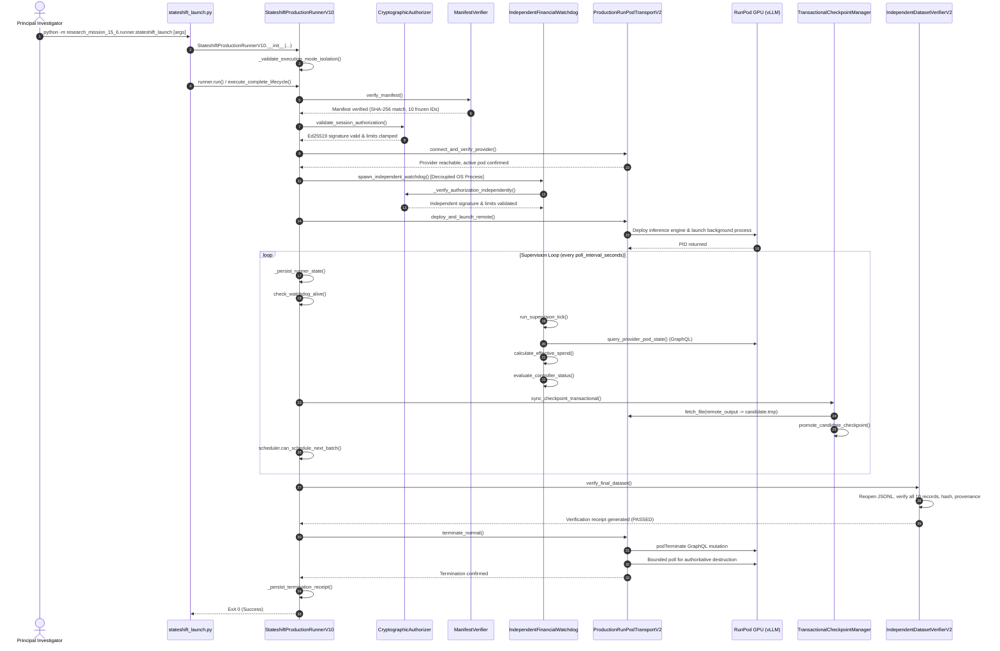

# StateShift Production Architecture: Complete End-to-End Call Graph

**Project:** StateShift Research Mission 15.6  
**Document:** `01_COMPLETE_PRODUCTION_CALL_GRAPH.md`  
**Purpose:** Forensic specification of complete runtime call graph, subsystem interactions, and data flows.

---

## 1. High-Level Architecture Call Flow

The production execution architecture is strictly decomposed into an orchestrating Main Controller process and a decoupled, independent OS Financial Watchdog daemon.

---

## 2. Step-by-Step Function & Method Call Hierarchy

### Phase 1: Canonical CLI Initialization & Argument Parsing
1. **`research_mission_15_6/runner/stateshift_launch.py:main()`**
   - Calls `parse_args()` to extract flags (`--mode`, `--experiment-id`, `--manifest`, `--authorization`, etc.).
   - Calls `resolve_manifest_path(mode, args.manifest)`:
     - For `calibration`: resolves `research_mission_15_6/manifests/calibration_10_manifest.json`.
     - For `production`: resolves `research_mission_15_6/manifests/primary_100_manifest.json`.
   - Calls `resolve_trusted_key(args.trusted_public_key)`.
   - Instantiates `StateshiftProductionRunnerV10(...)`.
   - Catches configuration / security exceptions, returning exit code `2`.

### Phase 2: Manifest & Cryptographic Authorization Gate
2. **`StateshiftProductionRunnerV10.execute_complete_lifecycle()`**
   - Calls `self.verify_manifest()`:
     - Reads physical bytes, computes SHA-256.
     - Verifies `self.manifest_sha256 == FROZEN_MANIFEST_SHA256` or parent hash match.
     - Enforces presence of all 10 frozen IDs from `FROZEN_CALIBRATION_REQUEST_IDS`.
     - Transitions state: `CREATED` $\rightarrow$ `MANIFEST_VERIFIED`.
   - Calls `self.validate_session_authorization()`:
     - Instantiates `CryptographicAuthorizer(trusted_public_key_b64, nonce_registry_path)`.
     - Calls `authorizer.verify_authorization(...)`.
     - Enforces Ed25519 signature validity, experiment binding, pod binding, and nonce freshness.
     - Clamps `effective_max_spend` and `effective_emergency_trigger`.
     - Transitions state: `MANIFEST_VERIFIED` $\rightarrow$ `AUTHORIZATION_VALIDATED`.

### Phase 3: Infrastructure Verification & Decoupled Watchdog Spawning
3. **`StateshiftProductionRunnerV10.connect_and_verify_provider()`**
   - Validates RunPod credentials and SSH reachability.
   - Transitions state: `AUTHORIZATION_VALIDATED` $\rightarrow$ `PROVIDER_CONNECTED`.
4. **`StateshiftProductionRunnerV10.spawn_independent_watchdog()`**
   - Constructs subprocess arguments:
     - `--experiment-id`, `--pod-id`, `--watchdog-dir`, `--session-id`
     - `--max-authorized`, `--emergency-trigger`, `--hourly-rate`, `--max-runtime`
     - `--poll-interval`, `--controller-heartbeat`, `--controller-pid`
     - `--authorization`, `--trusted-public-key`, `--pre-existing-uptime`
   - Spawns decoupled OS process using `subprocess.Popen(..., preexec_fn=os.setpgrp)`.
   - Transitions state: `PROVIDER_CONNECTED` $\rightarrow$ `WATCHDOG_SPAWNED`.
5. **`IndependentFinancialWatchdog.__init__()`**
   - Calls `_verify_authorization_independently()` directly inside watchdog process.
   - Enforces cryptographic validity independently of controller memory.
   - Writes `watchdog_pid_{experiment_id}.pid`.
   - Initializes `WatchdogLifecycleState.ACTIVE`.

### Phase 4: Remote Deployment & Inference Launch
6. **`StateshiftProductionRunnerV10.deploy_and_launch_remote()`**
   - Uploads scripts via `RunPodTransportV2.push_file()`.
   - Executes remote deployment verifier via SSH.
   - Spawns remote inference runner: `nohup python3 remote_experiment_runner.py ... &`.
   - Records remote PID.
   - Transitions state: `WATCHDOG_SPAWNED` $\rightarrow$ `DEPLOYMENT_VERIFIED` $\rightarrow$ `INFERENCE_RUNNING`.

### Phase 5: Supervised Execution & Transactional Checkpointing Loop
7. **`StateshiftProductionRunnerV10.run_supervision_loop()`**
   - Enters polling loop with cycle time `poll_interval_seconds`:
     - **Controller Heartbeat:** Calls `_persist_runner_state()`.
     - **Watchdog Health Audit:** Calls `check_watchdog_alive()` checking OS PID and heartbeat timestamp.
     - **External Termination Detection:** Reads `watchdog_state_{experiment_id}.json`.
     - **In-Process Cost Controller:** Calls `self.cost_controller.check_and_enforce_budget()`.
     - **Transactional Checkpoint Sync:** Calls `self.sync_checkpoint_transactional()`.
       - Fetches remote candidate file `output.jsonl` $\rightarrow$ `dataset.candidate.tmp`.
       - Calls `TransactionalCheckpointManager.promote_candidate_checkpoint()`.
       - Atomically promotes valid candidate via `os.replace()`.
     - **Budget Scheduler Gate:** Calls `self.scheduler.can_schedule_next_batch()`.
     - **Target Completion Check:** If rollouts reach target (10 for calibration, 400 for production), breaks loop.
   - Transitions state: `INFERENCE_RUNNING` $\rightarrow$ `REMOTE_COMPLETE`.

### Phase 6: Dataset Integrity Verification Gate
8. **`StateshiftProductionRunnerV10.verify_final_dataset()`**
   - Transitions state: `REMOTE_COMPLETE` $\rightarrow$ `FINAL_DATASET_VERIFICATION`.
   - Reopens physical dataset from disk.
   - Calls `IndependentDatasetVerifierV2.verify_final_local_dataset()`.
   - Audits all 20 metadata keys, greedy decoding parameters, prompt SHA-256, model ID, and completion status.
   - Verifies exact 10 records matching frozen calibration IDs.
   - Generates and fsyncs `verification_receipt.json`.
   - Transitions state: `FINAL_DATASET_VERIFICATION` $\rightarrow$ `LOCAL_VERIFIED`.

### Phase 7: Provider Destruction & Termination Confirmation
9. **`StateshiftProductionRunnerV10.terminate_normal()`**
   - Dispatches `podTerminate` GraphQL mutation to RunPod API.
   - Enters bounded verification retry loop (up to 5 attempts with backoff).
   - Polls `query_provider_pod_state()` until pod is authoritatively `DELETED` or `AUTHORITATIVE_NOT_FOUND`.
   - Writes final `termination_receipt_{experiment_id}.json` with `confirmed_by_provider: true`.
   - Transitions state: `LOCAL_VERIFIED` $\rightarrow$ `PROVIDER_TERMINATION_CONFIRMED` $\rightarrow$ `FINISHED`.
   - Exits with return code `0`.
