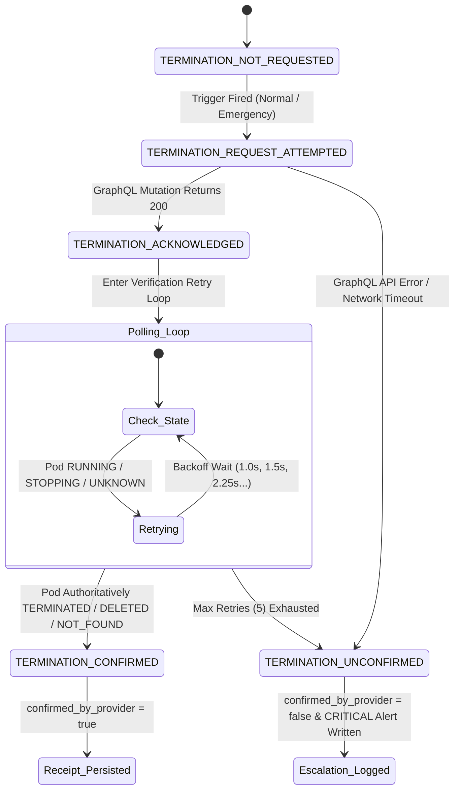

# StateShift Mission 15.6: Termination Reliability & Recovery Audit

**Project:** StateShift Research Mission 15.6  
**Document:** `08_TERMINATION_AND_RECOVERY_AUDIT.md`  
**Focus:** Provider Pod Termination State Machine, Durable Retries, & Escalation  

---

## 1. Termination State Machine Architecture

Pod termination is the most critical financial safety operation in StateShift. A failure to terminate a paid cloud pod can rapidly deplete account balances. Mission 15.6 implements a formal 5-state durable termination state machine:



---

## 2. Bounded Retry Logic with Exponential Backoff

When termination is dispatched:
1. **Mutation Dispatch:** Sends `podTerminate(input: {podId: $podId})` via GraphQL.
2. **Initial Acknowledgment:** Verifies HTTP 200 and absence of GraphQL errors. Sets `TERMINATION_ACKNOWLEDGED`.
3. **Verification Polling Loop:**
   - Loop runs for up to $N = 5$ attempts.
   - Polling query: `pod(input: {podId: $podId}) { desiredStatus, runtime { uptimeInSeconds } }`.
   - Backoff starts at $1.0\text{s}$ and scales by $1.5\times$ up to $5.0\text{s}$.
4. **Authoritative Destruction Classification:**
   - Authoritative confirmed destruction states: `TERMINATED`, `DELETED`, or `AUTHORITATIVE_NOT_FOUND` (GraphQL `pod` field returns `null`).
   - Non-destruction states: `RUNNING`, `STOPPING`, `STOPPED` (still incurs storage fees), `UNKNOWN`.

---

## 3. Unconfirmed Escalation Handling

If 5 verification attempts elapse without authoritative proof of destruction:
1. **Never Falsely Claim Destruction:** `self.termination_confirmed` remains strictly `False`.
2. **Durable State:** Transitions to `TerminationDurableState.TERMINATION_UNCONFIRMED` and `WatchdogLifecycleState.TERMINATION_UNCONFIRMED`.
3. **Termination Receipt:** Writes `watchdog_termination_receipt_{exp_id}.json` with `"confirmed_by_provider": false`.
4. **Critical Operational Alert File:** Immediately creates an operational escalation file:
   `alerts/CRITICAL_UNCONFIRMED_TERMINATION_{pod_id}.json` containing:
   ```json
   {
     "timestamp_utc": 1729861200.0,
     "iso_time": "2026-10-25T13:00:00Z",
     "pod_id": "xydg2t4rzrx71d",
     "experiment_id": "stateshift-calibration-10",
     "session_id": "exec_1729860000",
     "attempts": 5,
     "reason": "Emergency trigger reached",
     "error": "Provider failed to confirm destruction or returned API errors. Operational escalation required."
   }
   ```
5. **Operator Intervention:** Alerts human operator to inspect the RunPod web console and execute manual termination if necessary.

---

## 4. Test Verification Traceability

- **`test_issue_d_durable_termination_success`**: Confirms transitions through `TERMINATION_CONFIRMED` when pod is destroyed.
- **`test_issue_d_durable_termination_unconfirmed_escalation`**: Verifies bounded retries, `TERMINATION_UNCONFIRMED` state, receipt with `confirmed: false`, and generation of the `CRITICAL_UNCONFIRMED_TERMINATION` alert file.
- **`test_scenario_K_provider_503_records_unconfirmed`**: Verifies end-to-end CLI behavior when provider returns API errors during termination.
- **`test_scenario_Q_ambiguous_provider_status_never_claims_destruction`**: Proves `STOPPED` status is never falsely reported as confirmed termination.
